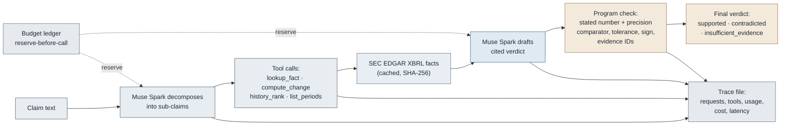
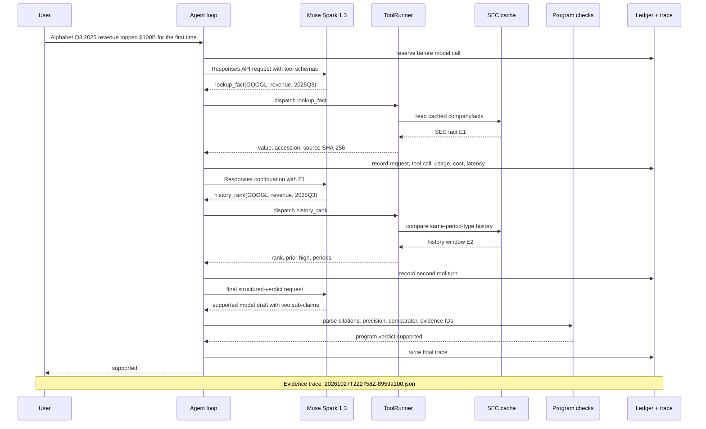
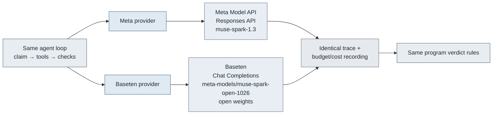
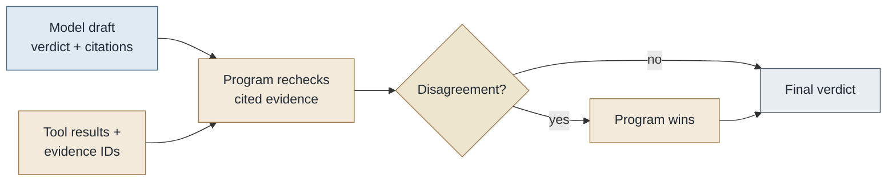

# market-claim-verifier

`market-claim-verifier` turns a financial sentence into atomic sub-claims, retrieves the relevant SEC EDGAR XBRL facts, and uses Muse Spark to draft a cited verdict. Python then rechecks the cited numbers and returns `supported`, `contradicted`, or `insufficient_evidence`. Built during the Meta Global AI Developer Hackathon starting 2026-10-27.

<!-- figure:hero:start -->


*AI-generated illustration: a sentence being checked against filings.* The reusable prompt is recorded in [`docs/prompts/hero-image.md`](docs/prompts/hero-image.md).
<!-- figure:hero:end -->

## The problem

- DappGo's AI-written stock commentary on 2026-10-26 failed its internal fact-assertion check; this repository is the focused response.
- One sentence can contain several atomic assertions: a value, a period-to-period change, and a record or first-time claim.
- A model can draft the explanation, but numbers, comparators, evidence IDs, budget reservations, and the final verdict need an auditable program path.

## What it does

<!-- diagram:how-a-claim-is-checked:start -->

<!-- diagram:how-a-claim-is-checked:end -->

The model selects tools and drafts the explanation. The program owns the numeric comparison, evidence validity, and claim-level aggregation. The product view is the verdict card:

<!-- figure:verdict-cards:start -->


*Two real traces, run 2026-10-27; each card shows the program verdict and cited SEC evidence.*
<!-- figure:verdict-cards:end -->

See the [flow source](docs/diagrams/how-a-claim-is-checked.mmd).

## Real results

The build log records five live claims before and after the Day 2 fixes. The chart below is generated from that table; the cards and linked JSON files are committed traces.

<!-- figure:before-after:start -->


*Before/after chart: n = 5 live claims from BUILD_LOG.md, run 2026-10-27.*
<!-- figure:before-after:end -->

<!-- figure:eval-summary:start -->

<!-- figure:eval-summary:end -->

| Live claim | Before → after | Evidence trace |
| --- | --- | --- |
| Meta Q2 2025 revenue was $47.5B, up 22% YoY | insufficient → supported | [trace](docs/evidence/2026-10-27/20261027T221321Z-79b60e38.json) |
| Tesla Q3 2025 net income about $1.4B; Alphabet Q4 2024 revenue exceeded $100B | contradicted → contradicted | [trace](docs/evidence/2026-10-27/20261027T221357Z-41db8b67.json) |
| Alphabet Q3 2025 revenue topped $100B for the first time | supported → supported; both parts checked | [trace](docs/evidence/2026-10-27/20261027T222758Z-8959a100.json) |
| Tesla revenue fell 10% YoY in Q3 2025 | insufficient → contradicted | [trace](docs/evidence/2026-10-27/20261027T221452Z-739ae70b.json) |
| Meta Q4 2026 revenue was $60B | insufficient → insufficient_evidence | [trace](docs/evidence/2026-10-27/20261027T221545Z-dbd136d9.json) |

The before/after labels and SEC actuals are in [`BUILD_LOG.md`](BUILD_LOG.md). The live-run cost and latency view is also reproducible:

<!-- figure:live-cost-latency:start -->


*Development runs, Day 1–2: n = 15 traces; not an evaluation.*
<!-- figure:live-cost-latency:end -->

### One real run

<!-- diagram:real-run-sequence:start -->

<!-- diagram:real-run-sequence:end -->

This sequence is the committed [`20261027T222758Z-8959a100.json`](docs/evidence/2026-10-27/20261027T222758Z-8959a100.json) run. Full source: [`docs/diagrams/real-run-sequence.mmd`](docs/diagrams/real-run-sequence.mmd).

## How Meta models are used

The agent loop is provider-neutral. Both paths record the same tool calls, evidence IDs, usage, cost, latency, and final program checks.

| Model | Provider | API | Role | Why |
| --- | --- | --- | --- | --- |
| `muse-spark-1.3` | Meta Model API | Responses API | Decomposes claims, calls tools, drafts a structured verdict | Function calling and structured-output path used by the primary provider |
| `meta-models/muse-spark-open-1026` | Baseten | OpenAI-compatible Chat Completions | Runs the same agent loop with plain JSON final output and one schema-repair request when needed | Muse Spark Open open-weights path and an independent provider |

Meta is the default provider. Baseten uses the OpenAI-compatible endpoint `https://inference.baseten.co/v1`; provider budgets are separate. Meta reads `MODEL_API_KEY` or `~/.config/dappgo/meta-model-api.env`, while Baseten reads `BASETEN_API_KEY` or `BASETEN_API_KEY_FILE`.

<!-- diagram:providers:start -->

<!-- diagram:providers:end -->

Full source: [`docs/diagrams/providers.mmd`](docs/diagrams/providers.mmd).

## Why you can trust a verdict

The model must cite the numeric evidence it used. Python parses the stated number and precision, applies direction words such as “fell” or “up,” checks the comparator, and rejects missing or ambiguous evidence. Any contradicted sub-claim makes the overall result contradicted; all supported sub-claims make it supported; otherwise the result is insufficient evidence.

| Comparator | Program rule |
| --- | --- |
| `eq` | Difference is at most the precision implied by the stated number |
| `approx` (value or absolute change) | Difference is at most `max(2 × precision, 2.5% of abs(stated))` |
| `approx` (percent change) | Difference is at most `max(2 × precision, 1.0 percentage point)` |
| `gt`, `lt` | Strict comparison; no tolerance |
| `gte`, `lte` | Equality is accepted within the stated precision |
| value-claim cap | Value tolerance is additionally capped at `10% × abs(stated value)` |

`history_rank` compares like periods only, includes derived Q4 values when available, and supplies the chronological window for record and first-time checks. Every factual assertion is represented as a sub-claim; assertions outside the available EDGAR checks stay unchecked.

<!-- diagram:model-vs-program:start -->

<!-- diagram:model-vs-program:end -->

Full source: [`docs/diagrams/model-vs-program.mmd`](docs/diagrams/model-vs-program.mmd).

## Built during the hackathon

[`BUILD_LOG.md`](BUILD_LOG.md) is the dated record of the work. No code in this repository predates 2026-10-27; the log covers the EDGAR client, agent loop, two providers, deterministic checks, evaluation harness, and the documentation and visuals in this submission.

## Run it

```bash
uv sync
.venv/bin/python -m claimcheck edgar META revenue 2025Q2
.venv/bin/python -m claimcheck verify --dry-run 'Meta Q2 2025 revenue was $47.5B, up 22% YoY'
.venv/bin/python -m claimcheck verify --provider baseten --dry-run 'Meta Q2 2025 revenue was $47.5B'
```

For a live run, keep the model key outside the repository (`MODEL_API_KEY` for Meta or `BASETEN_API_KEY` for Baseten). Keys are never written to traces or the append-only budget ledger. A live run writes its trace and ledger under `runs/`.

`verify` also accepts `--model`, `--budget`, `--max-output-tokens`, and `--reasoning-effort`. Tool turns default to 4,000 output tokens and the final verdict to 3,000; the CLI flag or environment setting can override both.

## Evaluation

The checked-in set is [`eval/claims.yaml`](eval/claims.yaml), with its independent gold facts in [`eval/gold_facts.json`](eval/gold_facts.json). It contains 30 claims split into 20 `dev` and 10 `test` claims. Evaluation compares `single_shot` and `agent` systems on both providers and records prompts, raw responses, token buckets, model/tool calls, cost, latency, and scoring fields.

**results pending** — the live evaluation is writing to `docs/evidence/eval-2026-10-27/`. After it completes:

```bash
.venv/bin/python -m claimcheck eval run \
  --split all \
  --systems single_shot@meta,agent@meta,single_shot@baseten,agent@baseten \
  --budget 2 \
  --out docs/evidence/eval-2026-10-27/
.venv/bin/python -m claimcheck eval report --out docs/evidence/eval-2026-10-27/
```

To inspect a plan without a key, model call, or network: `.venv/bin/python -m claimcheck eval run --dry-run --split dev`. `single_shot@*` receives no tools; `agent@*` uses the SEC cache and deterministic checks. A failed or budget-stopped pair counts as missing and is not silently retried. Prompt exports are checked with `python -m claimcheck prompts export`.

## Technical notes

`lookup_fact` returns period type and duration. Additive flows can be derived from annual minus nine-month YTD or from YTD differences, with source components retained; EPS and share counts are not derived. Period labels use SEC frames when present and dates otherwise, not fiscal `fp` labels. The EDGAR client reads local cache files when available, sends the configured contact User-Agent for a cache miss, and records the source SHA-256 in evidence.

Tool turns reserve worst-case cost before every model call, then reconcile actual usage. Incomplete responses are retried once with a doubled limit; Baseten plain JSON is schema-validated and repaired once when needed. Prompt source files live in [`prompts/`](prompts/), and the figure builder is [`docs/scripts/make_figures.py`](docs/scripts/make_figures.py).

This project is not investment advice.
