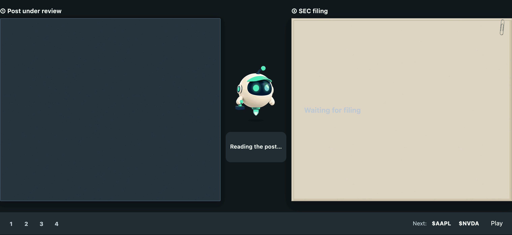
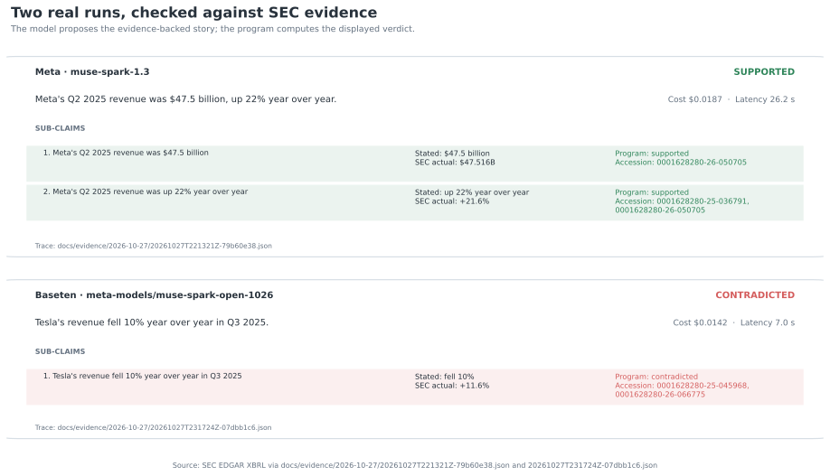
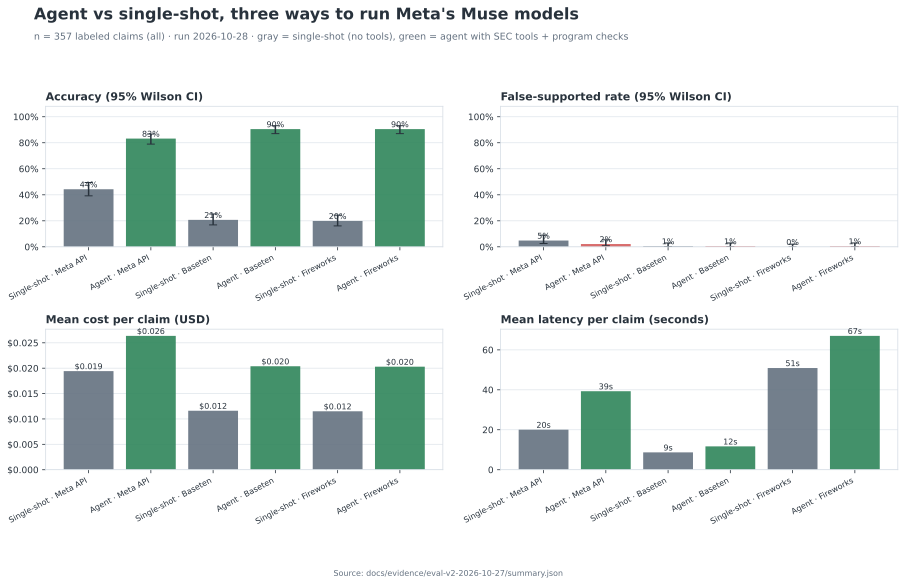
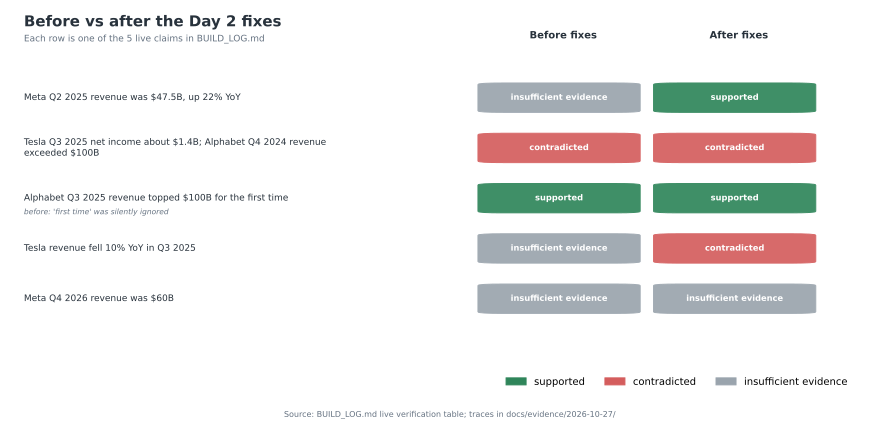
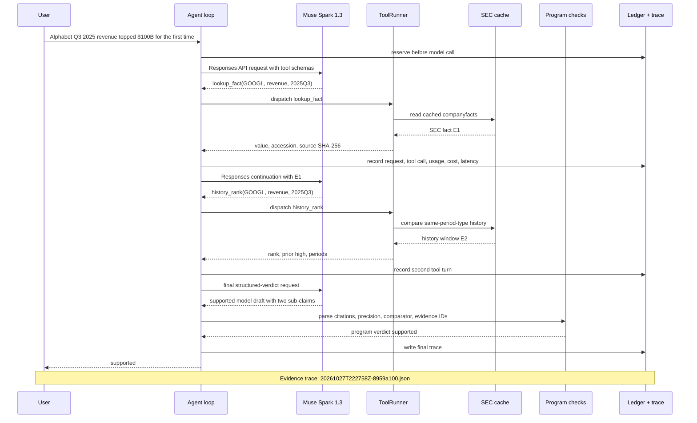
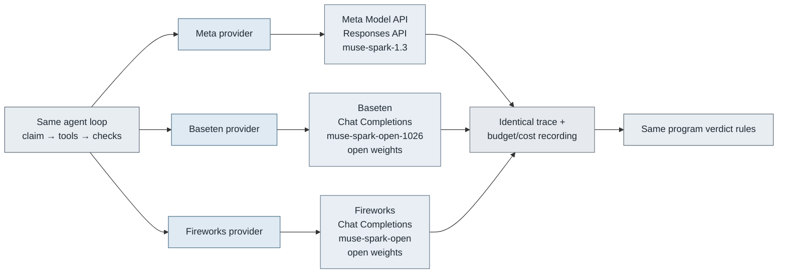
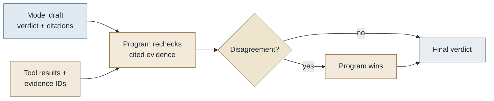
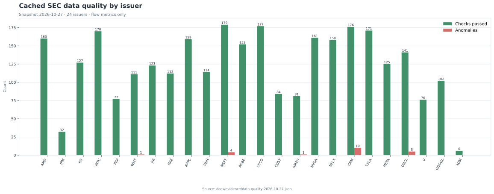
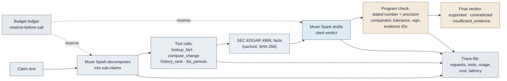

# Market Claim Verifier

[English](README.md) · [繁體中文](README.zh-TW.md)

**Check financial claims against SEC filings with Meta’s open-weight Muse Spark Open, and inspect the evidence behind each verdict.**

Baseten · Muse Spark Open verifier, original held-out text split, corrected reference labels:

| Correct | False support | Mean cost / claim |
| --- | --- | --- |
| **[240/266 = 90.2%](docs/evidence/eval-v2-2026-10-27/REPORT.md#metrics)** | **[1/139](docs/evidence/eval-v2-2026-10-27/REPORT.md#per-gold-class-precision-and-recall)** non-supported claims accepted | **[≈ $0.02](docs/evidence/eval-v2-2026-10-27/REPORT.md#metrics)** ($0.019880 recorded) |

**Apple: “$416.2B in one quarter” → the full year.** Fiscal Q4 2025 revenue was **$102.5B**; the claim is about **4×** the quarter. [Saved check and calculation](docs/evidence/posts-2026-10-28/demo-thread-baseten/report.json) · [Readable report](docs/evidence/posts-2026-10-28/demo-thread-baseten/report.html).

**[Live demo](https://hackathon.dappgo.com/)** · **[Judge guide](JUDGES.md)** · [Video — TODO (Claude)](JUDGES.md#demo-video-todo) · [Run it locally](#run-it)

The website replays saved checks without a key; live verification uses the local CLI. Browser uploads are planned. [Study and product limits](JUDGES.md#limits).

<p align="center">
  <a href="https://hackathon.dappgo.com/"></a>
</p>

[](.github/workflows/verify.yml) [](LICENSE)

## Try it

Start with [Amazon's Q3 2023 revenue claim](https://hackathon.dappgo.com/explorer/#G0119). Compare the sentence with its SEC evidence, then inspect the recorded model and program decisions. The [three-outcome walkthrough](docs/evidence/judge-walkthrough/REPORT.md) shows a matching number, an altered number and a wrong-period claim through offline program checks.

For real company materials, open the [Microsoft earnings-call review](docs/evidence/real-av-context-live/REPORT.md) or [Tesla multi-document review](docs/evidence/stock-context-posthoc-2026-10-30/REPORT.md). Each preserves the original quotation, evidence, calculations and unresolved questions.

Pending links: [Live check — TODO (Claude)](JUDGES.md#live-check-todo) · [In the wild — TODO (Claude)](JUDGES.md#in-the-wild-todo).

<a id="key-results"></a>
<a id="text-verification-266-held-out-claims"></a>

## Why Meta open weights

On the same [held-out claims](docs/evidence/eval-v2-2026-10-27/REPORT.md#metrics), **Muse Spark Open with tools and program checks scored 90.2% on Baseten, versus 82.0% for hosted Muse Spark 1.3**, at similar observed cost: about **$0.020 vs $0.026 per claim**.

| Platform / model | Verifier correct | No-tool baseline correct | False support¹ | Mean verifier cost | Evidence |
| --- | ---: | ---: | ---: | ---: | --- |
| Baseten · Muse Spark Open | 240/266 · **90.2%** | 56/266 · 21.1% | 1/139 | $0.019880 | [Recorded results](docs/evidence/eval-v2-2026-10-27/REPORT.md) |
| Fireworks · Muse Spark Open | 237/266 · **89.1%** | 51/266 · 19.2% | 1/139 | $0.019973 | [Recorded results](docs/evidence/eval-v2-2026-10-27/REPORT.md) |
| Meta · Muse Spark 1.3 | 218/266 · **82.0%** | 111/266 · 41.7% | 4/139 | $0.025880 | [Recorded results](docs/evidence/eval-v2-2026-10-27/REPORT.md) |

¹ False support means accepting a claim whose reference label is contradicted or insufficient. This table uses only the [266 held-out claims](docs/evidence/eval-v2-2026-10-27/REPORT.md#metrics); failures count as wrong.

**Portability:** the same agent loop runs on Baseten and Fireworks with the same tools, evidence IDs, budget recording and Python checks. The recorded open-weight results above demonstrate both host routes. [Provider adapters](src/claimcheck/providers.py) · [Exact model IDs and run manifest](docs/evidence/eval-v2-2026-10-27/manifest.json).

Meta also supplies audio transcription through **`muse-voice-transcribe-1.0`**, plus Muse Spark OCR for images and sampled video frames, before text verification on the selected host. [Media adapter](src/claimcheck/ingest_media.py) · [Recorded audio/video review](docs/evidence/real-av-context-live/REPORT.md).

## Agentic: Muse chooses the next check; Python checks the answer

- **Muse decides what to investigate.** It selects tools and arguments: `lookup_fact`, `list_periods` to resolve available periods, `compute_change` for comparisons, `history_rank` for record claims, or `find_earnings_release` then `quote_release` for eligible guidance and non-GAAP evidence. It cites the returned evidence in a draft verdict. [Tool definitions](src/claimcheck/tools.py) · [Release tools](src/claimcheck/release_tools.py).
- **Python executes and validates.** It performs calculations, checks periods, units, precision, direction and evidence IDs, validates release bytes and quote offsets, and determines the final verdict. Budget reservations happen before model calls. [Program checks](src/claimcheck/checks.py) · [Release checks](src/claimcheck/release_checks.py) · [Budget ledger](src/claimcheck/budget.py).

In a [real Alphabet trace](docs/evidence/2026-10-27/20261027T222758Z-8959a100.json), Muse first chooses `lookup_fact`, then `history_rank` to investigate “for the first time”; Python checks the cited evidence before returning the verdict. [Sequence diagram](docs/diagrams/real-run-sequence.mmd).

## What it does

1. **Preserve the source.** Extract a financial claim with its original quote and page, frame or audio location where available.
2. **Retrieve evidence.** Meta Muse models select SEC facts and eligible issuer-release passages for the company and period.
3. **Check the claim.** Python validates citations, numbers, units, comparisons and rounding. Final explanations follow the program verdict; the model's draft remains in the trace.
4. **Review the result.** Open the HTML report or reuse its JSON. A single-stock review combines multiple files and keeps incomplete documents visible.

| Result | Meaning |
| --- | --- |
| `supported` | The recorded evidence supports the extracted claim within the checked period and tolerance. |
| `contradicted` | Valid evidence conflicts with the claim; the report shows the checked values. |
| `insufficient_evidence` | A necessary period, source or supported check is missing. It is not a verdict that the claim is false. |

Uploaded documents supply the claims to examine. They do not automatically become trusted financial evidence.

## Support and boundaries

Try text, Markdown, images, native-text PDFs, audio or video through the CLI. All verifier routes share these input adapters; images and media use Meta OCR/ASR. [Supported formats](docs/PROVIDERS.md#current-repository-input-contract) · [Input and source boundaries](JUDGES.md#input-and-source-boundaries) · [Real company materials and controlled studies](JUDGES.md#media-studies).

<!-- multimodal-v1:start -->
[Controlled-format results and limits](JUDGES.md#controlled-format-study) · [Reuse frozen inputs and outputs](docs/evidence/fair-multimodal-v1/REUSE.md).
<!-- multimodal-v1:end -->

## Run it

The CLI needs Python 3.12–3.14 and `uv`. Audio/video processing also needs FFmpeg and ffprobe.

```sh
git clone https://github.com/YanlongLai/market-claim-verifier.git
cd market-claim-verifier
uv sync

# Inspect a request without making a model call.
uv run python -m claimcheck verify --provider baseten --dry-run \
  'Meta Q2 2025 revenue was $47.5B'
```

Set `BASETEN_API_KEY` in your environment, then run a live check with a $1 budget ceiling:

```sh
uv run python -m claimcheck verify --provider baseten --budget 1 \
  'Meta Q2 2025 revenue was $47.5B'
```

Use `MODEL_API_KEY` for Meta or `FIREWORKS_API_KEY` for Fireworks. Live verification needs network access; traces and budget records are saved under `runs/`. Media preprocessing additionally needs a Meta key.

### Check a whole post

```sh
uv run python -m claimcheck post examples/posts/bigtech-thread.txt \
  --provider baseten --budget 1
```

The post report retains quotations, evidence and program checks in HTML and JSON. [Recorded English and Chinese examples](docs/evidence/posts-2026-10-28/).

### Review several files for one stock

`review-stock` combines a bounded file queue with a stock-level summary. `stock-summary` aggregates saved reports without another model call. The [multi-file guide](docs/STOCK_REVIEW.md) covers budgets, frozen evidence, resuming work and exports; the [event-context guide](docs/EVENT_CONTEXT.md) explains how to supply a reviewed period without inserting it into the original speech.

<a id="other-inputs"></a>
<a id="local-pdf-input"></a>
For a single image, audio file, video or text PDF, use `ingest`. [Commands and limits](docs/PROVIDERS.md#current-repository-input-contract).

## Cost, speed and provider choice

A document's cost includes preprocessing, claim extraction and every verification turn. The headline is the [recorded held-out text-verifier mean](docs/evidence/eval-v2-2026-10-27/REPORT.md#metrics). [Costs, latency and dated provider rates](docs/PROVIDERS.md) · [Cost accounting and Batch limits](JUDGES.md#cost-accounting) · [Latest recorded follow-up spend](docs/evidence/real-av-context-live/REPORT.md#spend-usd-estimatedreserved).

## Real-world test

The original [DappGo News study](docs/evidence/real-world-2026-11-02/REPORT.md) recorded the pre-fix agent and post CLI on **80 paraphrased stories**: 60 numerical financial statements and 20 support controls, across Baseten, Fireworks and Meta API. Gold and runtime hashes were locally committed before model execution; original third-party headlines and summaries remain only in ignored cache.

Only **four** items have independently resolved SEC truth labels. **23 US financial items need review**, and **53 scope-only labels measure expected abstention**, including Taiwan claims and non-financial controls. Coverage, latency, costs, failures and source/type breakdowns are reported for every item; scope agreement is not broad factual accuracy. [Gold review list](docs/evidence/real-world-2026-11-02/GOLD_REVIEW.md) · [Next Owner-provided Reels and YouTube inputs](docs/evidence/real-world-2026-11-02/NEXT_SOURCES.md).

All six provider/path combinations abstained on the four SEC-confirmed positive cases. The study also exposes an issuer-binding failure: five combinations compare Taiwan's Hon Precision with **Honeywell (`HON`)** and return a contradiction. This is an invalid correction. [Retained traces and next work](docs/evidence/real-world-2026-11-02/findings.md).

A post-freeze input review found one translated company-name error and one ambiguous forecast issuer. The [errata](docs/evidence/real-world-2026-11-02/PARAPHRASE_REVIEW.md) retain the original runs, provide the known correction, and mark corrected-input behavior untested; these cases have no factual truth score.

The 480 item/path evaluations used **$5.3361 in ledger estimates/reservations**: Baseten $1.5528, Fireworks $1.5872 and Meta $2.1961, each below its $10 task cap. Failed attempts and unknown-usage reservations remain included; these are not provider invoices.

Phase 2 adds **30 of 107 own Threads posts, all 48 supplied third-party paraphrases and two real own-post cards**, through three providers and actual image ingest. The external collection came from logged-in, Owner-authorised **Top** search results; reliable engagement counts were unavailable. Five third-party items have independent SEC truth labels, 36 items have scope expectations, and 37 need review. Own-post and media factual accuracy are not estimable from this gold. The [combined source tables](docs/evidence/real-world-2026-11-02/REPORT.md#threads) retain every result and cost. Displayed auto-translations contain confirmed unit/period discrepancies; original-language translation causation remains unverified. All six image routes failed before verification: four incomplete claim extractions, one extraction timeout and one incomplete OCR response. Every route and cost is retained under a shared $8 cap per billed provider. [Frozen phase-2 protocol](docs/evidence/real-world-2026-11-02/threads/protocol.json) · [Owner-provided audio/video plan](docs/evidence/real-world-2026-11-02/NEXT_SOURCES.md).

On the five truth-labelled Threads items, each provider scored **2/5 direct** (40%; Wilson 95% CI 11.8–76.9%) and **3/5 post** (60%; 23.1–88.2%). Failures count wrong; these selected, correlated items do not establish broad accuracy. Phase-2 ledger estimates/reservations total **$10.537241**: Baseten $3.311842, Fireworks $3.316011 and Meta $3.909388, including all media calls and failures. Both phases total **$15.873363**.

The separately recorded [POST-HOC FIX RECHECK](docs/evidence/real-world-2026-11-03-fixcheck/REPORT.md) uses these same seen inputs after repairs. **The inputs and failures were seen before the fixes; this is not held-out evidence.** Original text and gold are unchanged; publication dates are now supplied as separate context. Both the initial recheck and separately registered adaptive routing repair retain before/after counts, failures and costs for all three providers on both paths. News and later Threads sets share a $5-per-provider ledger, including failed calls and unknown usage.

The adaptive repeat supports **4/4 original SEC-confirmed positives on five paths** and **3/4 on Fireworks post**, where UnitedHealth timed out and counts wrong. Every original path scored 0/4. Across both retained attempts, ledger estimates/reservations are **$2.1730 Baseten, $2.6954 Fireworks and $2.7280 Meta**, each below $5. This four-positive development panel does not establish broad accuracy or a factual false-supported rate.

The repairs add exact SEC issuer binding, filing-date-backed relative periods, component-derived net/operating/gross margins and YoY growth, narrowly scoped segment revenue, 6-K releases, investment income, US comparable sales, annual minimum guidance and explicit unit-error notes on contradictions. A missing date, ambiguous period or unsupported issuer/metric still yields insufficient evidence. The [frozen recheck protocol](docs/evidence/real-world-2026-11-03-fixcheck/sets/news/protocol.json) discloses changed date context and concurrency. Threads phase 2 ran on the pre-fix agent; a post-fix Threads recheck can use a separately frozen set under the same remaining caps. No OCR/ASR was retested.

For dated text, `verify` and `post` accept `--published-at 2026-10-29T22:13:49Z`; this supplies the source date separately and limits eligible filing dates. Add `--issuer-country` and `--issuer-exchange` when known. These are constraints to check against SEC identity evidence, not substitutes for a matching company name.

## Limitations

See [JUDGES.md — Limits](JUDGES.md#limits) for study design, source scope, media recall, conditional event context and cost accounting.

## Reproduce or extend

Run `sh scripts/verify.sh` to check fixtures, Python/Node tests, figures, data rebuilds and links. The complete verifier also needs Node 22+. Dependency installation may use the network; verification then runs offline without model credentials. [Verification guide](AGENTS.md) · [Test records and reusable inputs/outputs](docs/TEST_RECORDS.md).

[Claim-extraction LoRA attempt (Nov 3 UTC)](docs/evidence/lora-2026-11-03/REPORT.md): Fireworks Muse Spark Open NVFP4 LoRA initialization succeeded, but matching tokenizer access blocked training. Estimated spend $0; no trained adapter, extraction scores, or provider change. [Support, rates, and feasibility evidence](docs/evidence/lora-2026-11-03/FEASIBILITY.md).

For new financial sources, start with the [extension guide](docs/EXTENDING.md), [evidence contract](docs/EVIDENCE_RECORDS.md) and [source policy](docs/DATA_SOURCES.md). The [delivery plan](docs/DAY5_PLAN.md) separates implemented features from the upload UI, wider real-data evaluation and cross-modal work still to come.

All repository code and demo work were created during the hackathon. [Build log](BUILD_LOG.md) · [Changelog](CHANGELOG.md) · [MIT code license](LICENSE) · [Data and media credits](CREDITS.md). English is the primary documentation language; source evidence retains its original language. [Language policy](docs/LANGUAGE.md).

## Technical reference

<details>
<summary>Historical studies, evidence rules, architecture and generated figures</summary>

The material below preserves the detailed study history and reproducible figures. Dates and study-specific limitations apply; current product status is described above.

<!-- figure:verdict-cards:start -->


*Two real traces, run 2026-10-27; each card shows the program verdict and cited SEC evidence.*
<!-- figure:verdict-cards:end -->

<details>
<summary>L4 earnings-release evidence</summary>

## L4 earnings-release evidence

Guidance and non-GAAP claims can use the issuer's SEC **8-K Item 2.02** or **6-K** earnings release, through SEC-indexed HTML Ex 99.1/99.2. Muse selects a candidate quote; Python rechecks the cached bytes, offsets, metric, period and numbers. A failed XBRL lookup can also trigger the same verified release route in program checks. L4 is furnished, unaudited and medium strength at most. Consolidated reported totals are also checked against XBRL; L1/L2 wins a conflict with `release_vs_filing_mismatch`. Missing outlooks and verbal ranges such as “low to mid single digits” return insufficient evidence.

The [source and comparison rules](docs/DATA_SOURCES.md#l4-parsing-and-decision-rules) and [independent 32-claim gold builder](eval/l4/GOLD_REVIEW.md) describe the supported scope. Rebuild gold with `.venv/bin/python eval/l4/build_gold.py`. After committing the gold and source fixtures, run `.venv/bin/python eval/l4/run_agent.py`; it uses Baseten's Meta Muse Spark Open, offline SEC snapshots, and one $5 budget for the entire run. Results belong in `docs/evidence/eval-l4-2026-10-29/`.

The [registered L4 run](docs/evidence/eval-l4-2026-10-29/ANALYSIS.md) scored **31/32 (96.9%; Wilson 95% CI 84.3–99.4%)**, with **0/19 false-supported** results, for **$0.7157**. This is a fixture-based regression benchmark; the one routing miss and post-run changes are retained and explained.


</details>

<details>
<summary>Real results</summary>

## Real results

The headline above uses the original held-out split. The figure below includes development claims as well; [historical totals, corrections, failures and post-hoc reruns](JUDGES.md#historical-results-and-failure-review) remain separately labeled in the judge guide.

<!-- figure:eval-summary:start -->


*Evaluation: n = 357 all claims, run 2026-10-28.*
<!-- figure:eval-summary:end -->

### How the system got there

Each failure found in a live run became a program rule, not a prompt tweak:

| Found in | Failure | Fix (program decides) |
| --- | --- | --- |
| Day 1 live run | Response truncated by the output limit | Detect `incomplete`, retry once, otherwise fail closed |
| Day 2 live runs | "about $1.4B" vs $1.373B; "exceeded $100B" treated as equality; "fell 10%" sign lost | Parse the stated number, precision and direction words from the claim text |
| Eval run 1 | Model chose `approx` for "$1.3 billion" → false "supported" (3 claims) | Comparator inferred from wording; model's choice only recorded |
| Eval run 1 | "Q4 2025" for Microsoft is false under both fiscal and calendar readings, model said "insufficient" | Check both readings; contradicted only if both contradict |
| Eval run 2 | Model wrote free text into evidence fields | Only real evidence IDs count |
| Fireworks run | Same fact cited twice under two labels | Collapse identical evidence |
| Real-world sample | SEC `fy`/`fp` describe the filing, not the period (Oracle's quarter ended Aug 2026 is tagged fiscal 2026; it is fiscal 2027 Q1) | Fiscal year and quarter derived from period dates and the issuer's year-end |
| v2 run review | Gold builder read Amazon's 10-Q trailing-twelve-month figures as fiscal years; lookup tool put Apple's 2023-07-01 quarter in calendar Q3 | 12-month periods not ending at fiscal year-end are labeled TTM; calendar quarter taken from the end date minus 7 days, as SEC frames do |

<!-- figure:before-after:start -->


*Before/after chart: n = 5 live claims from BUILD_LOG.md, run 2026-10-27.*
<!-- figure:before-after:end -->

<!-- figure:live-cost-latency:start -->
Development-run cost and latency is documented in [`docs/VISUALS.md`](docs/VISUALS.md); the evaluation figure above is the results view.
<!-- figure:live-cost-latency:end -->

### One real run

<!-- diagram:real-run-sequence:start -->

<!-- diagram:real-run-sequence:end -->

This sequence is the committed [`20261027T222758Z-8959a100.json`](docs/evidence/2026-10-27/20261027T222758Z-8959a100.json) run. Full source: [`docs/diagrams/real-run-sequence.mmd`](docs/diagrams/real-run-sequence.mmd).


</details>

<details>
<summary>How Meta models are used</summary>

## How Meta models are used

The agent loop is provider-neutral. Both paths record the same tool calls, evidence IDs, usage, cost, latency, and final program checks.

| Model | Provider | API | Role | Why |
| --- | --- | --- | --- | --- |
| `muse-spark-1.3` | Meta Model API | Responses API | Decomposes claims, calls tools, drafts a structured verdict | Function calling and structured-output path used by the primary provider |
| `meta-models/muse-spark-open-1026` | Baseten | OpenAI-compatible Chat Completions | Runs the same agent loop with plain JSON final output and one schema-repair request when needed | Muse Spark Open open-weights path and an independent provider |
| `accounts/fireworks/models/muse-spark-open` | Fireworks | OpenAI-compatible Chat Completions | Runs the same agent loop with plain JSON final output and one schema-repair request when needed | Muse Spark Open open-weights path and an independent provider |

Meta is the default provider. Baseten uses the OpenAI-compatible endpoint `https://inference.baseten.co/v1`, and Fireworks uses `https://api.fireworks.ai/inference/v1`; provider budgets are separate. Meta reads `MODEL_API_KEY` or `~/.config/dappgo/meta-model-api.env`, Baseten reads `BASETEN_API_KEY` or `BASETEN_API_KEY_FILE`, and Fireworks reads `FIREWORKS_API_KEY` or `FIREWORKS_API_KEY_FILE` (default `~/secret/fireworks-api-key.txt`).

<!-- diagram:providers:start -->

<!-- diagram:providers:end -->

Full source: [`docs/diagrams/providers.mmd`](docs/diagrams/providers.mmd).


</details>

<details>
<summary>Why you can trust a verdict</summary>

## Why you can trust a verdict

The model must cite the numeric evidence it used. Python parses the stated number and precision, applies direction words such as “fell” or “up,” checks the comparator, and rejects missing or ambiguous evidence. Any contradicted sub-claim makes the overall result contradicted; all supported sub-claims make it supported; otherwise the result is insufficient evidence.

| Comparator | Program rule |
| --- | --- |
| `eq` | Difference is at most the precision implied by the stated number |
| `approx` (value or absolute change) | Difference is at most `max(2 × precision, 2.5% of abs(stated))` |
| `approx` (percent change) | Difference is at most `max(2 × precision, 1.0 percentage point)` |
| `gt`, `lt` | Strict comparison; no tolerance |
| `gte`, `lte` | Equality is accepted within the stated precision |
| value-claim cap | Value tolerance is additionally capped at `10% × abs(stated value)` |

`history_rank` compares like periods only, includes derived Q4 values when available, and supplies the chronological window for record and first-time checks. Every factual assertion is represented as a sub-claim; assertions outside the available EDGAR checks stay unchecked.

<!-- diagram:model-vs-program:start -->

<!-- diagram:model-vs-program:end -->

Full source: [`docs/diagrams/model-vs-program.mmd`](docs/diagrams/model-vs-program.mmd).


</details>

<details>
<summary>Evidence you can audit</summary>

## Evidence you can audit

Every number in a verdict carries its provenance ([`docs/DATA_SOURCES.md`](docs/DATA_SOURCES.md), [`sources/registry.yaml`](sources/registry.yaml)):

| Level | Source | Meaning |
| --- | --- | --- |
| L1 | 10-K (annual report) | Audited; the issuer is legally liable for it |
| L2 | 10-Q (quarterly report) | Reviewed, not audited |
| L3 | Derived by the program | e.g. Q4 = annual − nine-month YTD; formula and source filings listed |

Each fact also reports how many filings confirm it, whether a later filing revised it, and an overall strength (high / medium / low). Guidance and non-GAAP figures are outside SEC XBRL facts; eligible claims can use [L4 issuer-release evidence](docs/DATA_SOURCES.md#l4-parsing-and-decision-rules). Claims without a supported source or check remain `insufficient_evidence`.

**The data itself is checked.** [`docs/DATA_QUALITY.md`](docs/DATA_QUALITY.md) runs consistency checks over 24 issuers' SEC data (quarters summing to the year, year-to-date totals, revisions). It found that **Oracle's 10-Ks filed in 2020–2022 tag full-year revenue for fiscal 2018, 2019, 2021 and 2022 on the fourth-quarter period** (e.g. $39.4B for March–May 2018). The verifier excludes those rows, derives the real quarter ($11.0B) and shows the excluded row in the evidence.

<!-- figure:data-quality:start -->


*Data-quality checks per issuer, SEC companyfacts snapshot 2026-10-27.*
<!-- figure:data-quality:end -->


</details>

<details>
<summary>Evaluation</summary>

## Evaluation

[`eval/claims.yaml`](eval/claims.yaml) holds 30 claims (20 `dev`, 10 `test`) across 11 trap categories — rounded and approximate values, inequalities, year-over-year changes with direction words, YTD-vs-quarter and fiscal-vs-calendar traps, unit traps, multi-part claims, first-time records and uncheckable claims. Gold facts come from [`eval/build_gold.py`](eval/build_gold.py), which reads raw SEC JSON with its own code and does not import the verifier.

[`eval/v2/`](eval/v2/) scales this to 357 claims (91 `dev`, 266 `test`) across 23 companies.

- **Programmatic claims:** [`generate.py`](eval/v2/generate.py) makes them deterministically from a fixed seed.
- **Paraphrases:** [`paraphrase.py`](eval/v2/paraphrase.py) has Muse Spark reword claims. Rewrites that drop a number, change a period, or comment on truth instead of rewording are rejected.
- **Real-world claims:** [`real.yaml`](eval/v2/real.yaml) records each one with source URL, tier and publication date. Claims are stored as paraphrases, never verbatim.

[`build.py`](eval/v2/build.py) recomputes every gold answer and refuses to build if any disagrees.

Each run records a manifest (code commit, model, prompts with SHA-256, data snapshot hashes, start/end time, ledger spend before and after), one trace per model call (request, raw response, reasoning tokens, cost, latency, rate-limit headers) and a report with Wilson confidence intervals, paired bootstrap intervals and McNemar tests. Prompts live in [`prompts/`](prompts/); a test fails if they drift from the code.

```bash
.venv/bin/python -m claimcheck eval run --split all \
  --systems single_shot@meta,agent@meta,single_shot@baseten,agent@baseten,single_shot@fireworks,agent@fireworks \
  --budget 5 --out docs/evidence/eval-<date>/
.venv/bin/python -m claimcheck eval report --out docs/evidence/eval-<date>/
```

`--dry-run` prints the plan and worst-case budget without a key or network. A failed or budget-stopped pair counts as wrong and is never silently retried.


</details>

<details>
<summary>Technical notes</summary>

## Technical notes

`lookup_fact` returns period type and duration. Additive flows can be derived from annual minus nine-month YTD or from YTD differences, with source components retained; EPS and share counts are not derived. Calendar labels (`2025Q3`) use SEC frames when present and dates otherwise; fiscal labels (`FY2027Q1`) are derived from each period's dates and the issuer's fiscal year-end, because SEC `fy`/`fp` describe the filing rather than the period. A quarter whose value equals its covering annual value is treated as a tagging error and excluded. The EDGAR client reads local cache files when available, sends the configured contact User-Agent for a cache miss, and records the source SHA-256 in evidence.

Tool turns reserve worst-case cost before every model call, then reconcile actual usage. Incomplete responses are retried once with a doubled limit; Baseten plain JSON is schema-validated and repaired once when needed. Prompt source files live in [`prompts/`](prompts/), and the figure builder is [`docs/scripts/make_figures.py`](docs/scripts/make_figures.py).

This project is not investment advice.


</details>

<details>
<summary>Architecture and claim-processing details</summary>

<!-- diagram:how-a-claim-is-checked:start -->

<!-- diagram:how-a-claim-is-checked:end -->

### Gap score

Each program check includes a deterministic gap assessment: relative error for levels, one-sided shortfall or
overshoot for thresholds, and percentage-point error for percent changes. Within tolerance is **Exact (100)**.
Otherwise the bands are **Minor** (<2% / <1 pp), **Moderate** (2–<10% / 1–<5 pp), **Major** (10–50% / 5–20 pp,
or wrong direction), and **Severe** (>50% / >20 pp). Otherwise the score is `max(0, 100 − 200 × relative_gap)`
or `max(0, 100 − 4 × pp_gap)`, with another 30 points deducted for wrong direction (floor 0).
This display signal leaves the verdict unchanged; CAN'T CHECK has no score. Existing reports can be updated
offline with `claimcheck.post.refresh_evidence(report_dir)`; `python docs/scripts/build_site.py --offline`
rebuilds the cards from saved checks and trace metadata without modifying the source reports.


</details>

Historical evidence selection: [verification policy and `--as-of`](docs/VERIFICATION_POLICY.md). Cutoffs use inclusive SEC filing dates, not archived historical API state.

<details>
<summary>Illustration credits and reusable prompts</summary>

<!-- figure:hero:start -->


*AI-generated illustration: a sentence being checked against filings.* The reusable prompt is recorded in [`docs/prompts/hero-image.md`](docs/prompts/hero-image.md).
<!-- figure:hero:end -->

The masthead captures the website review scene. The standalone Hover animation is also retained: [rebuild the mascot GIF](docs/scripts/build_readme_robot.py); [static version](docs/site/img/auditor/H/present.webp). [Robot art direction and generation history](docs/prompts/site/auditor-robot.md). AI artwork is illustrative; numerical charts use recorded data.

</details>

</details>
