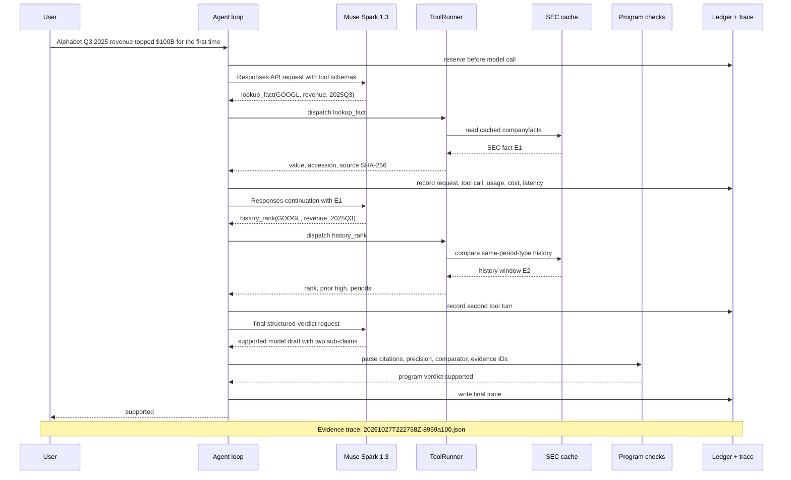
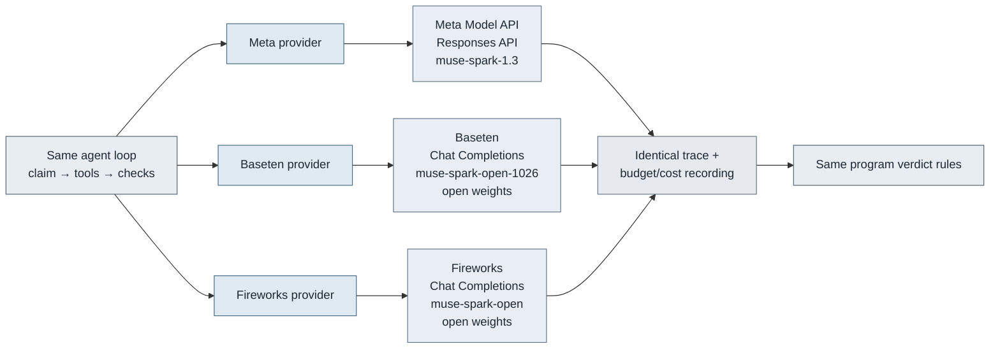
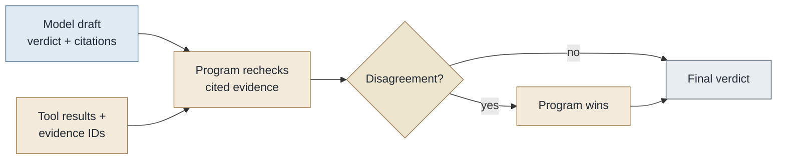
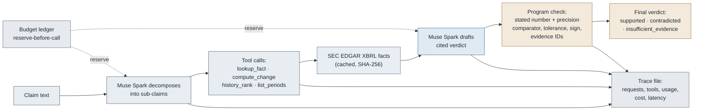

# Market Claim Verifier

[English](README.md) · [繁體中文](README.zh-TW.md)

**Check financial claims against SEC filings, with the evidence behind each result.**

A financial statement can use the right number with the wrong quarter, unit or accounting basis. Market Claim Verifier extracts claims from US equity research and company materials, retrieves filing evidence, and checks the numbers in Python. Each result preserves the original quotation, source, calculation and any unresolved questions.

**[Explore a recorded review](https://hackathon.dappgo.com/explorer/#G0119)** · [Product demo](https://hackathon.dappgo.com/) · [Run a live check](#run-it) · [Judge guide](JUDGES.md)

The website presents saved results and requires no API key. Live checks run through the local CLI; a browser upload workflow is still planned.

<p align="center">
  <a href="https://hackathon.dappgo.com/"></a>
</p>

[](.github/workflows/verify.yml) [](LICENSE)

## Try it

Start with [Amazon's Q3 2023 revenue claim](https://hackathon.dappgo.com/explorer/#G0119). Compare the sentence with its SEC evidence, then inspect the recorded model and program decisions. The [three-outcome walkthrough](docs/evidence/judge-walkthrough/REPORT.md) shows what happens to a matching number, an altered number and a wrong-period claim.

For a real-media example, follow the [Microsoft earnings-call review](docs/evidence/real-av-context-live/REPORT.md): the original recording, extracted claims, separately supplied event period, and subsequent filing checks are all retained. The result includes both supported claims and a claim that still lacks enough context.

## What it does

1. **Preserve the source.** Extract a financial claim with its original quote and page, frame or audio location where available.
2. **Retrieve evidence.** Meta Muse models select SEC facts and eligible issuer-release passages for the company and period.
3. **Check the claim.** Python validates citations, numbers, units, comparisons and rounding. Final explanations follow the program verdict; the model's draft remains in the trace.
4. **Review the result.** Open the HTML report or reuse its JSON. A single-stock review combines multiple files and keeps incomplete documents visible.

| Result | Meaning |
| --- | --- |
| `supported` | The recorded evidence supports the extracted claim within the checked period and tolerance. |
| `contradicted` | Valid evidence conflicts with the claim; the report shows the checked values. |
| `insufficient_evidence` | A necessary period, source or supported check is missing. It is not a verdict that the claim is false. |

Uploaded documents supply the claims to examine. They do not automatically become trusted financial evidence.

## Key results

### Text verification: 266 held-out claims

The original evaluation contains 357 claims across 23 companies: 91 development claims and **266 held-out claims**. The table below uses only the held-out split. The no-tool baseline and verifier use the same model within each platform; the verifier adds retrieval and program checks.

| Platform / model | Verifier correct | No-tool baseline correct | False support¹ |
| --- | ---: | ---: | ---: |
| Meta · Muse Spark 1.3 | 218/266 · **82.0%** | 111/266 · 41.7% | 4/139 |
| Baseten · Muse Spark Open | 240/266 · **90.2%** | 56/266 · 21.1% | 1/139 |
| Fireworks · Muse Spark Open | 237/266 · **89.1%** | 51/266 · 19.2% | 1/139 |

¹ Claims labeled contradicted or insufficient in the reference set but accepted as supported by the verifier; denominator includes all 139 such test cases.

Failures and incomplete responses count as wrong. These are recorded results from the original evaluation, using corrected reference labels; two label corrections and later post-hoc runs are disclosed in the [full report](docs/evidence/eval-v2-2026-10-27/REPORT.md). The corpus combines generated financial cases and paraphrased source sentences. These scores do not establish real-world multimedia accuracy.

### Real company materials: what improved, what remains unresolved

In a genuine Microsoft earnings-call excerpt, the audio says “this quarter” while the slide says “FY27 Q1.” The initial workflow could read the numbers but could not safely bind the period. A separate, reviewed event-context record made the period explicit without changing the original quotation.

In the subsequent six-claim check, **Baseten and Fireworks each supported five claims**: revenue, net income, diluted EPS, operating income and revenue growth. Both kept the unchanged, undated adjusted-EPS control as insufficient evidence. Meta returned one supported, two insufficient and three HTTP 500 failures.

For example, the filing value **$92.279B** supports the slide's **$92.3B revenue** at its displayed precision. That conclusion is conditional on the supplied fiscal Q1 2027 context. It does not certify the whole recording. [Results, evidence and failures](docs/evidence/real-av-context-live/REPORT.md) · [Original WAV and MP4](eval/real-av-v1/README.md).

Three real Tesla slides also have a [multi-document review](docs/evidence/stock-context-posthoc-2026-10-30/REPORT.md). Its unresolved chart led to an explicit coverage warning: reading chart labels does not verify bar heights or series values. [Chart diagnosis](docs/evidence/chart-diagnosis-2026-10-30/REPORT.md).

<details>
<summary>Controlled comparison across nine input formats</summary>

<!-- multimodal-v1:start -->

Six issuers, 24 underlying assertions, nine encodings—not 216 independent facts. Cells show correct / 24; missing, incomplete and wrong outcomes remain in the denominator. All providers use the same files and frozen Meta OCR/ASR text.

| Format | Meta | Baseten | Fireworks |
| --- | ---: | ---: | ---: |
| TXT | 22/24 | 24/24 | 24/24 |
| Markdown | 22/24 | 24/24 | 24/24 |
| PDF | 23/24 | 24/24 | 24/24 |
| PNG | 24/24 | 24/24 | 24/24 |
| JPEG | 22/24 | 24/24 | 24/24 |
| WebP | 23/24 | 24/24 | 24/24 |
| WAV | 18/24 | 23/24 | 24/24 |
| MP3 | 14/24 | 24/24 | 24/24 |
| MP4 | 19/24 | 24/24 | 24/24 |

One controlled run on clean inputs, with synthetic audio and video. Separate native-image probes completed 6/6 PNG, JPEG and WebP inputs per provider; response completion is not financial accuracy. Native audio/video endpoints were not tested in this comparison.

[Methods, failures and limits](docs/evidence/fair-multimodal-v1/REPORT.md) · [Reusable inputs, outputs and offline replay](docs/evidence/fair-multimodal-v1/REUSE.md).

<!-- multimodal-v1:end -->

</details>

## Support and boundaries

All three text-verifier routes accept the same repository formats. Images and media use **Meta OCR/ASR**, including when Baseten or Fireworks performs the text verification.

| Input | Processing | Main boundary |
| --- | --- | --- |
| Text / Markdown | Local text → chosen verifier | Claim extraction is bounded. |
| PNG / JPEG / WebP | Meta OCR → chosen verifier | Chart geometry and image authenticity are not verified. |
| Text PDF | Local page extraction → chosen verifier | No scanned-PDF OCR or cross-page context. |
| Audio | Meta ASR → chosen verifier | Speaker labels do not establish identity; timestamps cover turns. |
| Video | Audio transcription + three OCR frames → chosen verifier | Unsampled visuals can be missed; audio and frames are checked separately. |

Scanned PDFs and general webpage URLs are not integrated. The local job queue is not a provider's discounted Batch API. [Detailed format limits and provider capabilities](docs/PROVIDERS.md).

## Run it

The CLI needs Python 3.12–3.14 and `uv`. Audio/video processing also needs FFmpeg and ffprobe.

```sh
git clone https://github.com/YanlongLai/market-claim-verifier.git
cd market-claim-verifier
uv sync

# Inspect a request without making a model call.
uv run python -m claimcheck verify --provider baseten --dry-run \
  'Meta Q2 2025 revenue was $47.5B'
```

Set `BASETEN_API_KEY` in your environment, then run a live check with a $1 budget ceiling:

```sh
uv run python -m claimcheck verify --provider baseten --budget 1 \
  'Meta Q2 2025 revenue was $47.5B'
```

Use `MODEL_API_KEY` for Meta or `FIREWORKS_API_KEY` for Fireworks. Live verification needs network access; traces and budget records are saved under `runs/`. Media preprocessing additionally needs a Meta key.

### Check a whole post

```sh
uv run python -m claimcheck post examples/posts/bigtech-thread.txt \
  --provider baseten --budget 1
```

The post report retains quotations, evidence and program checks in HTML and JSON. [Recorded English and Chinese examples](docs/evidence/posts-2026-10-28/).

### Review several files for one stock

`review-stock` combines a bounded file queue with a stock-level summary. `stock-summary` aggregates saved reports without another model call. The [multi-file guide](docs/STOCK_REVIEW.md) covers budgets, frozen evidence, resuming work and exports; the [event-context guide](docs/EVENT_CONTEXT.md) explains how to supply a reviewed period without inserting it into the original speech.

<a id="other-inputs"></a>
<a id="local-pdf-input"></a>
For a single image, audio file, video or text PDF, use `ingest`. [Commands and limits](docs/PROVIDERS.md#current-repository-input-contract).

## Cost, speed and provider choice

A document's cost includes preprocessing, claim extraction and every verification turn. The historical 357-claim text study averaged approximately **$0.020 per claim** for Baseten/Fireworks and **$0.026** for Meta. Those are observed workflow costs, not per-document prices or service guarantees. [Recorded costs and latency](docs/evidence/eval-v2-2026-10-27/REPORT.md).

Published rate snapshot, checked 2026-10-30; USD per million tokens:

| Platform / model | Input | Cached input | Output |
| --- | ---: | ---: | ---: |
| Meta · Muse Spark 1.3 Standard | $1.25 | $0.15 | $4.25 |
| Baseten · Muse Spark Open | $1.25 | $0.15 | $4.25 |
| Fireworks · Muse Spark Open | $1.25 | $0.15 | $4.25 |

Meta ASR was listed at $0.18/hour; image OCR uses tokens. Ledger estimates include failed attempts and reservations and are not vendor invoices. [Official rate sources and Batch caveats](docs/PROVIDERS.md#price-comparison) · [Latest recorded follow-up spend](docs/evidence/real-av-context-live/REPORT.md#spend-usd-estimatedreserved).

## Limitations

The current scope is US equities and supported SEC/issuer evidence. Tagging errors, restatements, fiscal calendars and missing non-GAAP evidence can change the result. Context supplied for an event is recorded as conditional metadata, not authenticated evidence.

Media extraction and claim recall remain incomplete. The real audio/video study uses one scene; the controlled format study uses synthetic media. Neither supports a claim of general financial-media accuracy. Reports are intended for reviewing statements, not issuing investment ratings.

## Reproduce or extend

Run `sh scripts/verify.sh` to check fixtures, Python/Node tests, figures, data rebuilds and links. The complete verifier also needs Node 22+. Dependency installation may use the network; verification then runs offline without model credentials. [Verification guide](AGENTS.md) · [Test records and reusable inputs/outputs](docs/TEST_RECORDS.md).

For new financial sources, start with the [extension guide](docs/EXTENDING.md), [evidence contract](docs/EVIDENCE_RECORDS.md) and [source policy](docs/DATA_SOURCES.md). The [delivery plan](docs/DAY5_PLAN.md) separates implemented features from the upload UI, wider real-data evaluation and cross-modal work still to come.

All repository code and demo work were created during the hackathon. [Build log](BUILD_LOG.md) · [Changelog](CHANGELOG.md) · [MIT code license](LICENSE) · [Data and media credits](CREDITS.md). English is the primary documentation language; source evidence retains its original language. [Language policy](docs/LANGUAGE.md).

## Technical reference

<details>
<summary>Historical studies, evidence rules, architecture and generated figures</summary>

The material below preserves the detailed study history and reproducible figures. Dates and study-specific limitations apply; current product status is described above.

<!-- figure:verdict-cards:start -->


*Two real traces, run 2026-10-27; each card shows the program verdict and cited SEC evidence.*
<!-- figure:verdict-cards:end -->

<details>
<summary>L4 earnings-release evidence</summary>

## L4 earnings-release evidence

Guidance and non-GAAP claims can use the issuer's SEC **8-K Item 2.02 Ex 99.1** earnings release (plus HTML Ex 99.2). Muse selects a candidate quote; Python rechecks the cached bytes, offsets, metric, period and numbers. L4 is furnished, unaudited and medium strength at most. Consolidated reported totals are also checked against XBRL; L1/L2 wins a conflict with `release_vs_filing_mismatch`. Missing outlooks and verbal ranges such as “low to mid single digits” return insufficient evidence.

The [source and comparison rules](docs/DATA_SOURCES.md#l4-parsing-and-decision-rules) and [independent 32-claim gold builder](eval/l4/GOLD_REVIEW.md) describe the supported scope. Rebuild gold with `.venv/bin/python eval/l4/build_gold.py`. After committing the gold and source fixtures, run `.venv/bin/python eval/l4/run_agent.py`; it uses Baseten's Meta Muse Spark Open, offline SEC snapshots, and one $5 budget for the entire run. Results belong in `docs/evidence/eval-l4-2026-10-29/`.

The [registered L4 run](docs/evidence/eval-l4-2026-10-29/ANALYSIS.md) scored **31/32 (96.9%; Wilson 95% CI 84.3–99.4%)**, with **0/19 false-supported** results, for **$0.7157**. This is a fixture-based regression benchmark; the one routing miss and post-run changes are retained and explained.


</details>

<details>
<summary>Real results</summary>

## Real results

**357 claims about 23 companies.** 260 are generated from SEC data across 10 trap families. 54 are model paraphrases of those. 43 are real sentences from news, aggregator and investor-relations pages, paraphrased.

- **Gold answers** come from an [independent script](eval/build_gold.py) and were **committed before any v2 run** ([`5d90b3b`](https://github.com/YanlongLai/market-claim-verifier/commit/5d90b3b)).
- **The run:** six systems, one code version, 2,142 verdicts ([report](docs/evidence/eval-v2-2026-10-27/REPORT.md)).

| System | Accuracy (95% CI) | Says "supported" when false | Mean cost / claim | Mean latency |
| --- | --- | --- | --- | --- |
| **Agent · Muse Spark Open on Baseten** | **323/357 = 90.5%** (87.0–93.1) | 1 / 186 | $0.020 | 12 s |
| **Agent · Muse Spark Open on Fireworks** | **323/357 = 90.5%** (87.0–93.1) | 1 / 186 | $0.020 | 67 s |
| **Agent · Muse Spark 1.3 on Meta Model API** | **297/357 = 83.2%** (79.0–86.7) | 4 / 186 | $0.026 | 39 s |
| Single-shot · Muse Spark 1.3 (no tools) | 158/357 = 44.3% (39.2–49.4) | 9 / 186 | $0.019 | 20 s |
| Single-shot · Muse Spark Open, Baseten | 74/357 = 20.7% (16.8–25.2) | 1 / 186 | $0.012 | 9 s |
| Single-shot · Muse Spark Open, Fireworks | 71/357 = 19.9% (16.1–24.3) | 0 / 186 | $0.012 | 51 s |

<!-- figure:eval-summary:start -->


*Evaluation: n = 357 all claims, run 2026-10-28.*
<!-- figure:eval-summary:end -->

- **The complete agent path outperformed single-shot on this recorded set.** On the same claims, agent accuracy beats single-shot by:
  - Meta API: **+38 points** (95% paired bootstrap CI +33 to +44).
  - Baseten: **+70** (+65 to +74).
  - Fireworks: **+70** (+65 to +76).

  McNemar p < 0.0001 for all three.
- **Real-world sentences:** the agent was right on 43/43 (Baseten, Fireworks) and 39/43 (Meta API). Single-shot was right on 6/43, because it mostly answers "insufficient evidence" for 2025–2026 numbers it cannot know.
- **Without tools, the hosted model guesses more.** Single-shot Muse Spark 1.3 said "supported" for 9 false claims. The open-weights model refused instead (0–1 false "supported").
- **Open weights are production-viable.** Muse Spark Open with the agent beat the hosted Muse Spark 1.3 agent by 7 points (paired CI +4 to +10, p = 0.0001). On Baseten it was also the fastest and cheapest.
- **Where the agent still fails:**
  - "First time / record" claims: 16–18 of 31 right.
  - Year-over-year claims on the Meta API: 29/48, against 45/48 on Baseten and Fireworks.
  - Fiscal-vs-calendar traps: 23–24 of 30.

  Per-family tables are in the [report](docs/evidence/eval-v2-2026-10-27/REPORT.md).
- **The remaining false "supported" verdicts trace to two causes.**
  - **A lookup-tool bug, now fixed.** Apple's quarter ending 2023-07-01 was treated as calendar Q3 instead of Q2.
  - **"Q2 2024" for a non-calendar issuer.** The Meta API agent checked only the fiscal reading. Both readings disagree here, so the gold answer is "insufficient evidence". Now fixed: the program fetches the missing reading itself (see the post-hoc rerun below).
- **Post-hoc rerun after both fixes (not pre-registered).** Same 357 claims, same corrected gold, the three agents only ([report](docs/evidence/eval-v2-2026-10-28-r2-posthoc/REPORT.md)). The fixes were made after seeing v2 failures, so treat this as a regression check, not a new held-out score.

  | Agent | v2 | Rerun | Says "supported" when false |
  | --- | --- | --- | --- |
  | Muse Spark Open on Fireworks | 90.5% | **329/357 = 92.2%** | 1 → **0** / 186 |
  | Muse Spark Open on Baseten | 90.5% | **325/357 = 91.0%** | 1 → **0** / 186 |
  | Muse Spark 1.3 on Meta Model API | 83.2% | **305/357 = 85.4%** | 4 → **0** / 186 |

  - All ambiguous-quarter claims the agents had called "supported" (G0235, G0240, G0249) are now "insufficient evidence".
  - The accuracy gains are within run-to-run noise (paired McNemar p = 0.15–0.79); the drop to zero false "supported" is the point.
  - The Meta API had 3 provider errors (two 400 tool-call errors, one 503), counted as wrong. Cost: $7–9 per provider.
- **Two gold answers were wrong, and the run exposed them.** The gold script had mistaken Amazon for a June year-end issuer: it read a trailing-twelve-month figure in a 10-Q as an annual period. That made two true Amazon claims "contradicted".
  - The frozen set is unchanged. Corrections are listed with reasons in [`eval/v2/claims-v2-corrected.jsonl`](eval/v2/claims-v2-corrected.jsonl), and the table above uses them.
  - Scores against the registered gold are in [`REPORT-registered-gold.md`](docs/evidence/eval-v2-2026-10-27/REPORT-registered-gold.md). Every system moves by at most 2 claims.
- **Honest scope:**
  - The held-out split is 266 claims: agent 90.2% on Baseten, 89.1% on Fireworks and 82.0% on the Meta API.
  - Meta API spend hit the run's $15 cap after 262 claims. The 95 stopped pairs were kept as evidence and resumed under a $30 cap ([`budget-stopped-attempt1/`](docs/evidence/eval-v2-2026-10-27/budget-stopped-attempt1/)).
  - The v1 set of 30 hand-reviewed claims and its six runs remain in [`docs/evidence/`](docs/evidence/). Run 4 there: agent 30/30 (Baseten, Fireworks), 26/30 (Meta API).

### How the system got there

Each failure found in a live run became a program rule, not a prompt tweak:

| Found in | Failure | Fix (program decides) |
| --- | --- | --- |
| Day 1 live run | Response truncated by the output limit | Detect `incomplete`, retry once, otherwise fail closed |
| Day 2 live runs | "about $1.4B" vs $1.373B; "exceeded $100B" treated as equality; "fell 10%" sign lost | Parse the stated number, precision and direction words from the claim text |
| Eval run 1 | Model chose `approx` for "$1.3 billion" → false "supported" (3 claims) | Comparator inferred from wording; model's choice only recorded |
| Eval run 1 | "Q4 2025" for Microsoft is false under both fiscal and calendar readings, model said "insufficient" | Check both readings; contradicted only if both contradict |
| Eval run 2 | Model wrote free text into evidence fields | Only real evidence IDs count |
| Fireworks run | Same fact cited twice under two labels | Collapse identical evidence |
| Real-world sample | SEC `fy`/`fp` describe the filing, not the period (Oracle's quarter ended Aug 2026 is tagged fiscal 2026; it is fiscal 2027 Q1) | Fiscal year and quarter derived from period dates and the issuer's year-end |
| v2 run review | Gold builder read Amazon's 10-Q trailing-twelve-month figures as fiscal years; lookup tool put Apple's 2023-07-01 quarter in calendar Q3 | 12-month periods not ending at fiscal year-end are labeled TTM; calendar quarter taken from the end date minus 7 days, as SEC frames do |

<!-- figure:before-after:start -->


*Before/after chart: n = 5 live claims from BUILD_LOG.md, run 2026-10-27.*
<!-- figure:before-after:end -->

<!-- figure:live-cost-latency:start -->
Development-run cost and latency is documented in [`docs/VISUALS.md`](docs/VISUALS.md); the evaluation figure above is the results view.
<!-- figure:live-cost-latency:end -->

### One real run

<!-- diagram:real-run-sequence:start -->

<!-- diagram:real-run-sequence:end -->

This sequence is the committed [`20261027T222758Z-8959a100.json`](docs/evidence/2026-10-27/20261027T222758Z-8959a100.json) run. Full source: [`docs/diagrams/real-run-sequence.mmd`](docs/diagrams/real-run-sequence.mmd).


</details>

<details>
<summary>How Meta models are used</summary>

## How Meta models are used

The agent loop is provider-neutral. Both paths record the same tool calls, evidence IDs, usage, cost, latency, and final program checks.

| Model | Provider | API | Role | Why |
| --- | --- | --- | --- | --- |
| `muse-spark-1.3` | Meta Model API | Responses API | Decomposes claims, calls tools, drafts a structured verdict | Function calling and structured-output path used by the primary provider |
| `meta-models/muse-spark-open-1026` | Baseten | OpenAI-compatible Chat Completions | Runs the same agent loop with plain JSON final output and one schema-repair request when needed | Muse Spark Open open-weights path and an independent provider |
| `accounts/fireworks/models/muse-spark-open` | Fireworks | OpenAI-compatible Chat Completions | Runs the same agent loop with plain JSON final output and one schema-repair request when needed | Muse Spark Open open-weights path and an independent provider |

Meta is the default provider. Baseten uses the OpenAI-compatible endpoint `https://inference.baseten.co/v1`, and Fireworks uses `https://api.fireworks.ai/inference/v1`; provider budgets are separate. Meta reads `MODEL_API_KEY` or `~/.config/dappgo/meta-model-api.env`, Baseten reads `BASETEN_API_KEY` or `BASETEN_API_KEY_FILE`, and Fireworks reads `FIREWORKS_API_KEY` or `FIREWORKS_API_KEY_FILE` (default `~/secret/fireworks-api-key.txt`).

<!-- diagram:providers:start -->

<!-- diagram:providers:end -->

Full source: [`docs/diagrams/providers.mmd`](docs/diagrams/providers.mmd).


</details>

<details>
<summary>Why you can trust a verdict</summary>

## Why you can trust a verdict

The model must cite the numeric evidence it used. Python parses the stated number and precision, applies direction words such as “fell” or “up,” checks the comparator, and rejects missing or ambiguous evidence. Any contradicted sub-claim makes the overall result contradicted; all supported sub-claims make it supported; otherwise the result is insufficient evidence.

| Comparator | Program rule |
| --- | --- |
| `eq` | Difference is at most the precision implied by the stated number |
| `approx` (value or absolute change) | Difference is at most `max(2 × precision, 2.5% of abs(stated))` |
| `approx` (percent change) | Difference is at most `max(2 × precision, 1.0 percentage point)` |
| `gt`, `lt` | Strict comparison; no tolerance |
| `gte`, `lte` | Equality is accepted within the stated precision |
| value-claim cap | Value tolerance is additionally capped at `10% × abs(stated value)` |

`history_rank` compares like periods only, includes derived Q4 values when available, and supplies the chronological window for record and first-time checks. Every factual assertion is represented as a sub-claim; assertions outside the available EDGAR checks stay unchecked.

<!-- diagram:model-vs-program:start -->

<!-- diagram:model-vs-program:end -->

Full source: [`docs/diagrams/model-vs-program.mmd`](docs/diagrams/model-vs-program.mmd).


</details>

<details>
<summary>Evidence you can audit</summary>

## Evidence you can audit

Every number in a verdict carries its provenance ([`docs/DATA_SOURCES.md`](docs/DATA_SOURCES.md), [`sources/registry.yaml`](sources/registry.yaml)):

| Level | Source | Meaning |
| --- | --- | --- |
| L1 | 10-K (annual report) | Audited; the issuer is legally liable for it |
| L2 | 10-Q (quarterly report) | Reviewed, not audited |
| L3 | Derived by the program | e.g. Q4 = annual − nine-month YTD; formula and source filings listed |

Each fact also reports how many filings confirm it, whether a later filing revised it, and an overall strength (high / medium / low). Guidance, non-GAAP figures, segment KPIs, deliveries, market share and share prices are outside SEC XBRL facts, so claims about them come back `insufficient_evidence` rather than a guess.

**The data itself is checked.** [`docs/DATA_QUALITY.md`](docs/DATA_QUALITY.md) runs consistency checks over 24 issuers' SEC data (quarters summing to the year, year-to-date totals, revisions). It found that **Oracle's 10-Ks filed in 2020–2022 tag full-year revenue for fiscal 2018, 2019, 2021 and 2022 on the fourth-quarter period** (e.g. $39.4B for March–May 2018). The verifier excludes those rows, derives the real quarter ($11.0B) and shows the excluded row in the evidence.

<!-- figure:data-quality:start -->


*Data-quality checks per issuer, SEC companyfacts snapshot 2026-10-27.*
<!-- figure:data-quality:end -->


</details>

<details>
<summary>Evaluation</summary>

## Evaluation

[`eval/claims.yaml`](eval/claims.yaml) holds 30 claims (20 `dev`, 10 `test`) across 11 trap categories — rounded and approximate values, inequalities, year-over-year changes with direction words, YTD-vs-quarter and fiscal-vs-calendar traps, unit traps, multi-part claims, first-time records and uncheckable claims. Gold facts come from [`eval/build_gold.py`](eval/build_gold.py), which reads raw SEC JSON with its own code and does not import the verifier.

[`eval/v2/`](eval/v2/) scales this to 357 claims (91 `dev`, 266 `test`) across 23 companies.

- **Programmatic claims:** [`generate.py`](eval/v2/generate.py) makes them deterministically from a fixed seed.
- **Paraphrases:** [`paraphrase.py`](eval/v2/paraphrase.py) has Muse Spark reword claims. Rewrites that drop a number, change a period, or comment on truth instead of rewording are rejected.
- **Real-world claims:** [`real.yaml`](eval/v2/real.yaml) records each one with source URL, tier and publication date. Claims are stored as paraphrases, never verbatim.

[`build.py`](eval/v2/build.py) recomputes every gold answer and refuses to build if any disagrees.

Each run records a manifest (code commit, model, prompts with SHA-256, data snapshot hashes, start/end time, ledger spend before and after), one trace per model call (request, raw response, reasoning tokens, cost, latency, rate-limit headers) and a report with Wilson confidence intervals, paired bootstrap intervals and McNemar tests. Prompts live in [`prompts/`](prompts/); a test fails if they drift from the code.

```bash
.venv/bin/python -m claimcheck eval run --split all \
  --systems single_shot@meta,agent@meta,single_shot@baseten,agent@baseten,single_shot@fireworks,agent@fireworks \
  --budget 5 --out docs/evidence/eval-<date>/
.venv/bin/python -m claimcheck eval report --out docs/evidence/eval-<date>/
```

`--dry-run` prints the plan and worst-case budget without a key or network. A failed or budget-stopped pair counts as wrong and is never silently retried.


</details>

<details>
<summary>Technical notes</summary>

## Technical notes

`lookup_fact` returns period type and duration. Additive flows can be derived from annual minus nine-month YTD or from YTD differences, with source components retained; EPS and share counts are not derived. Calendar labels (`2025Q3`) use SEC frames when present and dates otherwise; fiscal labels (`FY2027Q1`) are derived from each period's dates and the issuer's fiscal year-end, because SEC `fy`/`fp` describe the filing rather than the period. A quarter whose value equals its covering annual value is treated as a tagging error and excluded. The EDGAR client reads local cache files when available, sends the configured contact User-Agent for a cache miss, and records the source SHA-256 in evidence.

Tool turns reserve worst-case cost before every model call, then reconcile actual usage. Incomplete responses are retried once with a doubled limit; Baseten plain JSON is schema-validated and repaired once when needed. Prompt source files live in [`prompts/`](prompts/), and the figure builder is [`docs/scripts/make_figures.py`](docs/scripts/make_figures.py).

This project is not investment advice.


</details>

<details>
<summary>Architecture and claim-processing details</summary>

<!-- diagram:how-a-claim-is-checked:start -->

<!-- diagram:how-a-claim-is-checked:end -->

### Gap score

Each program check includes a deterministic gap assessment: relative error for levels, one-sided shortfall or
overshoot for thresholds, and percentage-point error for percent changes. Within tolerance is **Exact (100)**.
Otherwise the bands are **Minor** (<2% / <1 pp), **Moderate** (2–<10% / 1–<5 pp), **Major** (10–50% / 5–20 pp,
or wrong direction), and **Severe** (>50% / >20 pp). Otherwise the score is `max(0, 100 − 200 × relative_gap)`
or `max(0, 100 − 4 × pp_gap)`, with another 30 points deducted for wrong direction (floor 0).
This display signal leaves the verdict unchanged; CAN'T CHECK has no score. Existing reports can be updated
offline with `claimcheck.post.refresh_evidence(report_dir)`; `python docs/scripts/build_site.py --offline`
rebuilds the cards from saved checks and trace metadata without modifying the source reports.


</details>

Historical evidence selection: [verification policy and `--as-of`](docs/VERIFICATION_POLICY.md). Cutoffs use inclusive SEC filing dates, not archived historical API state.

<details>
<summary>Illustration credits and reusable prompts</summary>

<!-- figure:hero:start -->


*AI-generated illustration: a sentence being checked against filings.* The reusable prompt is recorded in [`docs/prompts/hero-image.md`](docs/prompts/hero-image.md).
<!-- figure:hero:end -->

The masthead captures the website review scene. The standalone Hover animation is also retained: [rebuild the mascot GIF](docs/scripts/build_readme_robot.py); [static version](docs/site/img/auditor/H/present.webp). [Robot art direction and generation history](docs/prompts/site/auditor-robot.md). AI artwork is illustrative; numerical charts use recorded data.

</details>

</details>
