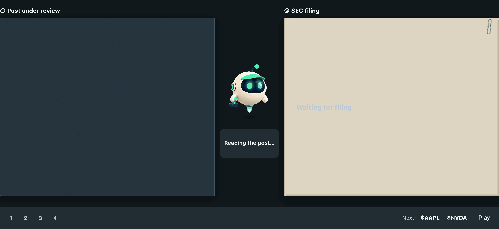
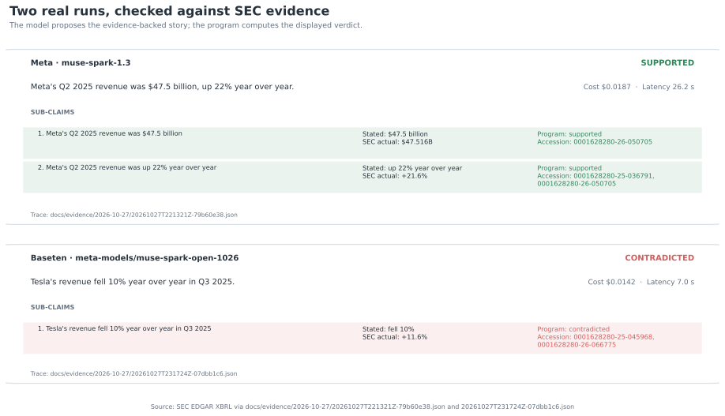
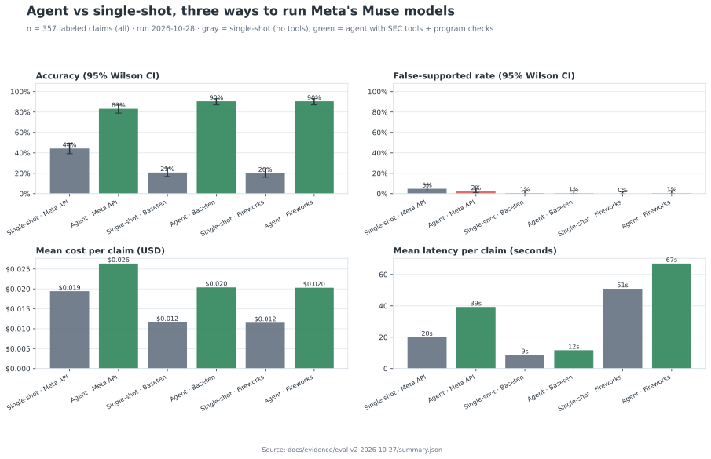
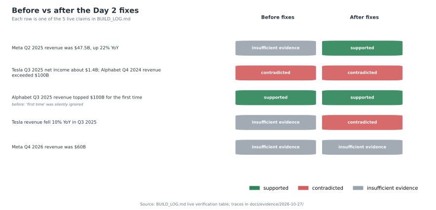
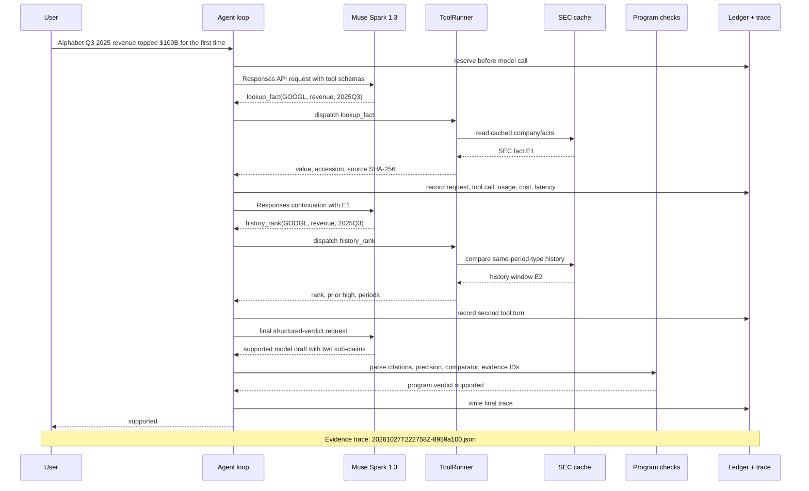
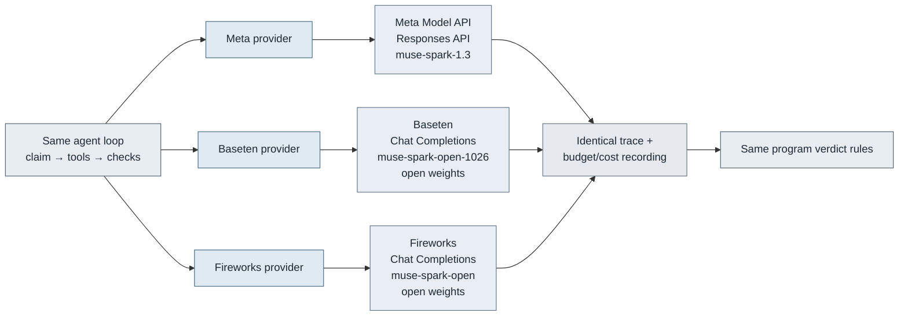
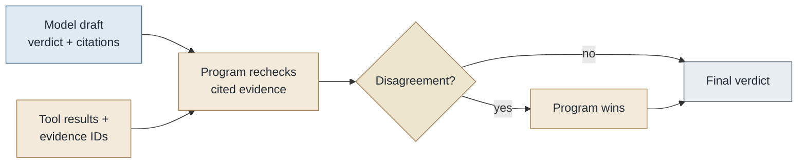
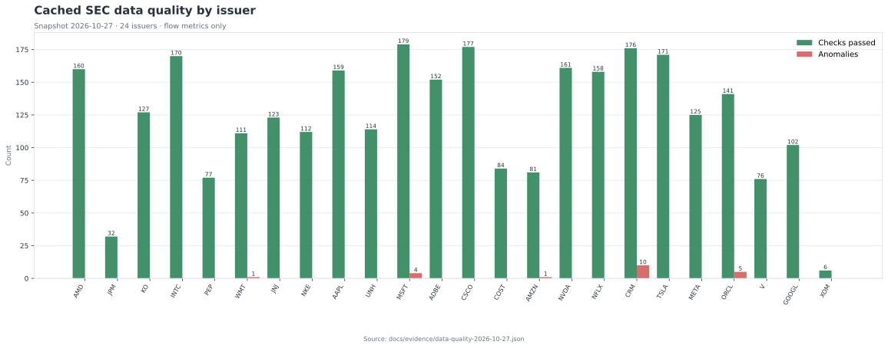
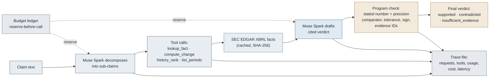

<p align="center">
  <a href="https://hackathon.dappgo.com/"></a>
</p>

# Market Claim Verifier

**English** | [繁體中文](README.zh-TW.md)

**Financial claims in. SEC evidence and auditable verdicts out.**

[🌐 Website](https://hackathon.dappgo.com/) · [🔎 Results explorer](https://hackathon.dappgo.com/explorer/) · [⚖️ Judge guide](JUDGES.md) · [🚀 Quick start](#run-it)

[](.github/workflows/verify.yml)
[](LICENSE)
[](BUILD_LOG.md)

Meta Muse models find claims and retrieve evidence. Python checks numbers, periods, units and citations. Scope: **US equities**, with SEC XBRL and issuer earnings releases.

> [!NOTE]
> The website replays saved results. Local CLI checks can call live models. An uploaded document is a claim source—not automatically trusted financial evidence.

**Jump to:** [Format support](#support-and-boundaries) · [Accuracy, cost & speed](#key-results) · [Media measurements](#media-cost-and-quality) · [API prices](#cost-speed-and-provider-choice) · [Run locally](#run-it) · [Limitations](#limitations)

## Support and boundaries

**Legend:** ✅ integrated, with a retained live probe for the example named in the cell · 🟡 integrated, but no retained live probe yet for that format/provider combination · — not integrated. Symbols describe repository routes and available test evidence, not accuracy or complete-content coverage. A tested example does not validate every extension or input in its format family.

| Input format | Meta text route: tested example | Baseten text route: tested example | Fireworks text route: tested example | Pipeline, dependencies and limits |
| --- | --- | --- | --- | --- |
| 📝 Text / Markdown | ✅ Text | ✅ Text | ✅ [Markdown](docs/evidence/input-formats-2026-10-30/markdown/ingest.html) | English / Chinese financial assertions; extraction is not exhaustive |
| 🖼️ PNG / JPEG / WebP | ✅ [PNG](docs/evidence/multimodal-2026-10-30/screenshot/ingest.html) | ✅ [JPEG](docs/evidence/input-formats-2026-10-30/jpeg/ingest.html) | ✅ [WebP](docs/evidence/input-formats-2026-10-30/webp/ingest.html) | **Meta OCR → chosen text provider**; every route needs a Meta key; no image-authenticity check |
| 📄 Native-text PDF | ✅ [PDF](docs/evidence/input-formats-2026-10-30/pdf/ingest.html) | 🟡 Integrated; not live-probed | 🟡 Integrated; not live-probed | Local page extraction → text checks; max 100 pages; no OCR or cross-page context |
| 📠 Scanned PDF | — | — | — | PDF OCR not implemented; unreadable pages remain unchecked |
| 🎙️ Audio files | ✅ [WAV](docs/evidence/multimodal-2026-10-30/audio-two-voices/ingest.html) | ✅ [WAV](docs/evidence/multimodal-2026-10-30/audio/ingest.html) | ✅ [MP3](docs/evidence/input-formats-2026-10-30/mp3/ingest.html) | **Meta ASR → chosen text provider**; every route needs a Meta key; turn-level timestamps, unverified speaker identity |
| 🎬 Video files | ✅ [MP4](docs/evidence/multimodal-2026-10-30/video/ingest.html) | ✅ [Captioned MP4](docs/evidence/multimodal-2026-10-30/video-captioned/ingest.html) | ✅ [Silent MP4†](docs/evidence/input-formats-2026-10-30/silent-video/ingest.html) | Meta ASR when audio exists + OCR of **three frames**; every route needs a Meta key; no full-video coverage |
| 🔗 General webpage URL | — | — | — | No login, browser rendering or arbitrary HTML ingestion |
| 📦 Provider-native batch | — | — | — | The local job queue is not a discounted vendor Batch API |

† Silent MP4 retained `partial` because the fixture has no audio track; all four extracted visual claims were program-checked. This demonstrates the sampled-visual route, not audio or whole-video verification. Preprocessing is automatic in the CLI; green media cells do **not** mean native Baseten/Fireworks media endpoints are integrated.

[Test-record index and reuse guide](docs/TEST_RECORDS.md) · **Live evidence:** [six additional format probes](docs/evidence/input-formats-2026-10-30/REPORT.md) record Markdown → Fireworks, JPEG → Meta OCR → Baseten, WebP → Meta OCR → Fireworks, MP3 → Meta ASR → Fireworks, silent MP4 → three Meta OCR frames → Fireworks, and native-text PDF → Meta. Each combination has one retained attempt with verdicts, coverage, latency and estimated cost. These small synthetic smoke tests are not a full format × provider benchmark. [Earlier PNG/WAV/video and long-audio probes](docs/evidence/multimodal-2026-10-30/REPORT.md) remain available.

**File limits:** 128 MiB; audio/video ≤2 hours. These are acceptance limits, not validated accuracy at that scale. [Extensions, vendor capabilities and endpoint caveats](docs/PROVIDERS.md#platform-capability-versus-integration).

## Key results

### 🔍 What are single-shot and agent?

**Single-shot asks the model to answer directly. Agent retrieves evidence, then lets Python check the answer.** These are two execution modes, not two model names. Within each provider's comparison, both modes use the same configured model.

```text
single_shot: claim → model answer → verdict
agent:       claim → model chooses SEC tools → evidence → model draft
                     → Python checks numbers, periods and citations → final verdict
```

| Question | Single-shot (`single_shot`) | Agent (`agent`) |
| --- | --- | --- |
| Does it retrieve SEC evidence? | No tools; answers from existing model knowledge | Yes, using SEC lookup and calculation tools |
| Who determines the verdict? | The model's answer | Program checks can override the model's draft |
| Can I inspect the supporting filing? | No retrieved filing evidence in this path | Cited facts and source links are retained |
| What does the comparison measure? | A no-tool baseline | The complete retrieval + program-checking workflow |

**Example:** for “Amazon's calendar Q3 2023 revenue was $143.1B,” the agent can retrieve $143.083B, verify the period and check rounding before returning `supported`. Single-shot may answer correctly or abstain, but does not retrieve that filing during the check. [Inspect the recorded example](https://hackathon.dappgo.com/explorer/#G0119).

> [!NOTE]
> “Single-shot” names the no-tool baseline; it does not guarantee exactly one API request. Consult recorded call counts for actual usage. Accuracy gains below measure the whole agent workflow, not the isolated effect of any one rule. `No-tool accuracy` means single-shot accuracy; cost and time columns show the **agent** path.

### 📝 Text: comparable recorded benchmark

**Same 357-claim set · 23 companies · 91 development + 266 held-out.** Corrected reference labels; failed/incomplete predictions count as wrong. Costs and latency are historical agent means—not prices per document or SLAs.

| Platform / Meta model | Agent accuracy | No-tool accuracy | False-supported¹ | Cost / claim | Mean time |
| --- | ---: | ---: | ---: | ---: | ---: |
| **Baseten · Spark Open** | **90.5%** (323/357) | 20.7% | 1/186 | **$0.020** | **12 s** |
| **Fireworks · Spark Open** | **90.5%** (323/357) | 19.9% | 1/186 | **$0.020** | **67 s** |
| **Meta API · Spark 1.3** | **83.2%** (297/357) | 44.3% | 4/186 | **$0.026** | **39 s** |

¹ Non-supported reference claims incorrectly accepted as supported. [Report, confidence intervals and methodology](docs/evidence/eval-v2-2026-10-27/REPORT.md). Two reference labels were corrected; the [original report](docs/evidence/eval-v2-2026-10-27/REPORT-registered-gold.md) remains available. Later reruns are post-hoc.

Baseten and Fireworks have the same total score but different correct cases. On the 266-claim held-out split alone, their scores are **240/266 = 90.2%** and **237/266 = 89.1%**, respectively. Equal overall accuracy does not imply identical behavior.

### 📊 Accuracy evidence by format and platform

| Format | Meta | Baseten | Fireworks |
| --- | --- | --- | --- |
| Text claims | **83.2%**, 357 claims | **90.5%**, 357 claims | **90.5%**, 357 claims |
| Images | Development probes only | JPEG probe with Meta OCR | WebP probe with Meta OCR |
| Native-text PDF | Native-text probe; no accuracy benchmark | No accuracy benchmark | No accuracy benchmark |
| Audio | Development probes only | Development probes with Meta ASR | MP3 probe with Meta ASR |
| Video | Development probes only | Development probes with Meta OCR/ASR | Silent MP4 probe with three Meta OCR frames |

> [!IMPORTANT]
> **Text accuracy does not transfer to PDF, images, audio or video.** Media quality also depends on reading/transcription and claim extraction. A development probe is not an accuracy benchmark. “No benchmark” means no measured benchmark accuracy, not 0% accuracy or unsupported.

## Media cost and quality

### 🧪 Recorded development examples—not platform rankings

Entire-file workflow estimates from the [2026-10-30 hardening report](docs/evidence/multimodal-2026-10-30/REPORT.md). Different inputs and settings mean these rows are **not controlled provider comparisons**. Reservations on failed calls may remain charged in the estimate.

| Format / recorded example | Pipeline | Total estimated cost | Wall time | Observed coverage / limitation |
| --- | --- | ---: | ---: | --- |
| 🖼️ Screenshot | Meta OCR + Meta text | **$0.0738** | **59.7 s** | 2/2 expected numeric mentions read; small synthetic control |
| 🎙️ Short audio | Meta ASR + Baseten text | **$0.0791** | **56.4 s** | 5/5 expected numeric assertions program-checked |
| 🎙️ Two-voice audio | Meta ASR + Meta text | **$0.0492** | **69.8 s** | Both voices merged into one speaker label |
| 🎙️ 12-minute audio | Meta ASR + Baseten text | **$0.2405** | **258.8 s** | 19/60 assertions checked in this historical run |
| 🎬 Row-only video | Meta OCR/ASR + Meta text | **$0.3359** | **312.1 s** | 8/9 assertions checked; only three frames sampled |
| 🎬 Captioned video | Meta OCR/ASR + Baseten text | **$0.1554** | **106.6 s** | 9/9 assertions checked in this control |

A [later long-audio follow-up](docs/evidence/multimodal-2026-10-30b/REPORT.md) increased program-checked coverage to 44/60; rechecking frozen ASR text reached 50/60. These are post-hoc coverage results on repeated synthetic facts, **not truth accuracy percentages**.

### Additional format probes — 2026-10-30

[Six preselected synthetic examples](docs/evidence/input-formats-2026-10-30/REPORT.md) cost **$0.32767930 total** against a $3 cap. All **15 extracted claim rows** received program checks; each case caught the deliberately incorrect EPS. This is not a full-content recall or general accuracy score, and different inputs/pipelines do not establish a platform ranking.

| Input | Pipeline | Checked / extracted | Estimated USD | Wall time |
| --- | --- | ---: | ---: | ---: |
| Markdown | Fireworks text | 2/2 | $0.031686 | 110.4 s |
| JPEG | Meta OCR → Baseten text | 2/2 | $0.039148 | 18.9 s |
| WebP | Meta OCR → Fireworks text | 2/2 | $0.034332 | 163.7 s |
| MP3 | Meta ASR → Fireworks text | 3/3 | $0.079938 | 444.1 s |
| Silent MP4 | Three Meta OCR frames → Fireworks text | 4/4 | $0.089863 | 463.6 s |
| Native-text PDF | Local page extraction → Meta text | 2/2 | $0.052712 | 71.8 s |

Five runs completed; silent MP4 retains `partial` because there is no audio track, although all four extracted visual claims were checked. Video remains limited to three sampled frames. PDF OCR, general URLs and native Baseten/Fireworks media endpoints were not tested or added. Costs are usage-based estimates, not invoices; displayed per-row amounts are rounded.

**API spend by provider for these six probes (USD):**

| Provider | Estimated API spend |
| --- | ---: |
| Meta | $0.07223290 |
| Baseten | $0.03489420 |
| Fireworks | $0.22055220 |
| **Total** | **$0.32767930** |

Based on the [per-request ledger](docs/evidence/input-formats-2026-10-30/ledger.jsonl). The total includes a $0.00240000 ASR reservation without a reconciliation event; it remains a conservative estimate. Meta's total includes OCR/ASR preprocessing used by other text providers and its own text checks. These are the **same costs** included in the per-input table, not extra charges. This is six-probe spend, not lifetime project spend or an official invoice.

**Reuse the evidence:** [record index and guide](docs/TEST_RECORDS.md) · [machine-readable run index](docs/evidence/input-formats-2026-10-30/runs.json) · [validation receipt and logs](docs/evidence/input-formats-2026-10-30/validation.json). Inputs/hashes, parameters, raw responses, traces, outcomes and costs are retained. Frozen OCR/ASR text can be reused for downstream checks without repeating media preprocessing; it does not retest extraction or attribution. Rebuilding the saved report is offline; a fresh live suite spends credits:

```sh
# Offline: rebuild the saved report and check input hashes / ledger totals.
python3 scripts/multimodal/build_format_report.py
# Paid: all six cases, shared $3 cap; requires a fresh output directory.
.venv/bin/python scripts/multimodal/run_format_suite.py --out-root runs/formats-001
```

## Cost, speed and provider choice

### 💵 Published API rates

USD per **1 million tokens**, checked **2026-10-30**. These are unit prices, separate from the workflow measurements above.

| Platform | Model | Input | Cached input | Output |
| --- | --- | ---: | ---: | ---: |
| Meta API | Muse Spark 1.3 Standard | $1.25 | $0.15 | $4.25 |
| Baseten | Muse Spark Open | $1.25 | $0.15 | $4.25 |
| Fireworks | Muse Spark Open | $1.25 | $0.15 | $4.25 |

| Additional stage | Cost basis | Applies to |
| --- | --- | --- |
| Meta image OCR | Token usage; no fixed per-image quote | Images and sampled video frames |
| Meta ASR | **$0.18/hour · $0.003/minute** | Audio and video audio tracks |
| Native PDF parsing | Local CPU; no model fee for extraction itself | Text PDFs; subsequent claim checks still cost tokens |
| Extraction + verification | Every model turn, including applicable retries | All accepted formats |

**Document cost = preprocessing + extraction + all claim-check calls.** A single file may contain dozens of claims. Ledger estimates are not invoices. Official rate links, Contributor-mode conditions and batch caveats are in the [provider comparison](docs/PROVIDERS.md#price-comparison).

## The problem

A plausible financial sentence can still use the wrong quarter, unit or comparison. This project grew out of a failed assertion check in DappGo's AI-written commentary. A fluent model explanation is not enough: each checkable number needs a source, a matching period and a reproducible comparison.

## Try it

Start with the [three-outcome walkthrough](docs/evidence/judge-walkthrough/REPORT.md): one official issuer source, a matching claim, a changed-number claim and a wrong-period claim. It runs offline with deterministic checks; it is not a live model demonstration.

Then open [claim G0119](https://hackathon.dappgo.com/explorer/#G0119) to inspect the original sentence, corrected reference label, six systems and the cited SEC filing. The explorer is a **saved replay**, with English by default and a Traditional Chinese switch. **Demo video publication is pending** ([record](demo/JUDGE_INTRO.md)).

## What it does

1. **Extract** individual assertions and preserve their original quotes.
2. **Retrieve** SEC facts or admitted issuer-release quotes for the entity and period.
3. **Check** numbers, units, precision, comparisons and evidence IDs in Python.
4. **Explain** the verdict with source locations, limitations, cost and traces.

<!-- figure:verdict-cards:start -->


*Two real traces, run 2026-10-27; each card shows the program verdict and cited SEC evidence.*
<!-- figure:verdict-cards:end -->

A completed run does not mean every assertion was found. Ingestion reports show accepted, program-checked, rejected and failed claim counts; full-content recall stays unknown without independently labeled input.

## Run it

Prerequisites: **Python 3.12–3.14**, **uv**, and **Node 22+** for the complete verifier. Audio/video additionally requires FFmpeg/ffprobe. Start from a local checkout.

**1. Verify the repository without model credentials.**

```sh
sh scripts/verify.sh
```

First use installs locked dependencies. Tests then run offline in a disposable copy, checking fixtures, Python/Node suites, figures, generated data and links. This verifies reproducibility, not live model accuracy. [Expected output](AGENTS.md#offline-verification).

**2. Install and inspect a request without spending API credit.**

```sh
uv sync
uv run python -m claimcheck verify --provider baseten --dry-run \
  'Meta Q2 2025 revenue was $47.5B'
```

**3. Run a bounded live check.** Set the selected provider credential outside the repository: `MODEL_API_KEY`, `BASETEN_API_KEY` or `FIREWORKS_API_KEY`.

```sh
uv run python -m claimcheck verify --provider baseten --budget 1 \
  'Meta Q2 2025 revenue was $47.5B'
```

Live checks require network access and may incur charges. Trace and budget records are saved under `runs/`. Use `--help` for model, reasoning and token limits.

## Check a whole post

```sh
uv run python -m claimcheck post examples/posts/bigtech-thread.txt \
  --provider baseten --budget 1
```

The output includes `report.json` and `report.html`, original quotes and links to program checks. Extraction is bounded; do not assume every financial assertion was found. [Recorded English and Chinese examples](docs/evidence/posts-2026-10-28/).

## Other inputs

```sh
uv run python -m claimcheck ingest tests/fixtures/multimodal/example-post.png \
  --provider baseten --budget 1 --out runs/example-input
```

Media preprocessing additionally requires Meta credentials, even when text verification uses another provider. Outputs are `ingest.json` and `ingest.html`; existing output directories are not overwritten. Consult [supported inputs](docs/PROVIDERS.md#current-repository-input-contract) before running your own file.

## Local PDF input

Use `ingest report.pdf` with the same provider/budget flags. Native text retains page locations and the file hash. Encrypted files are rejected; blank/scanned pages remain visibly unchecked. Limits are 100 pages, 100,000 extracted characters per page and 1,000,000 per document. Tables and reading order require review.

## Limitations

- SEC tagging errors, amended filings and fiscal calendars can affect the evidence; source provenance is part of the result.
- Missing periods, unsupported metrics and unresolved evidence can yield `insufficient_evidence`.
- Multimedia tests use a small set of development controls, not a general real-call benchmark.
- Three video frames do not cover every slide. Speaker labels do not establish who spoke.
- This hackathon scope is US equities; Taiwan data and general web scraping are outside it.

## Extend and contribute

Read the [extension guide](docs/EXTENDING.md), [evidence record contract](docs/EVIDENCE_RECORDS.md) and [prioritized delivery plan](docs/DAY5_PLAN.md). New sources need authority rules, immutable snapshots, exact locators and independent evaluation—not only a new prompt. [Roadmap](ROADMAP.md) · [Changelog](CHANGELOG.md).

## Built during the hackathon

All repository code and demo work were created for the event; no repository code pre-existed. [Build log](BUILD_LOG.md) · [dated history](CHANGELOG.md) · [MIT code license](LICENSE) · [data and media credits](CREDITS.md).

## Language policy

English is primary. Chinese supplementary explanations are welcome; original evidence and model outputs keep their recorded language. [Language policy](docs/LANGUAGE.md). 中文補充：介面與文件以英文為主；證據保持原文，避免翻譯改變查核含義。

## Technical reference

The following expandable sections retain detailed rules, historical experiments and reproducible diagrams. They are supporting material, not additional current benchmark claims.

<details>
<summary>L4 earnings-release evidence</summary>

## L4 earnings-release evidence

Guidance and non-GAAP claims can use the issuer's SEC **8-K Item 2.02 Ex 99.1** earnings release (plus HTML Ex 99.2). Muse selects a candidate quote; Python rechecks the cached bytes, offsets, metric, period and numbers. L4 is furnished, unaudited and medium strength at most. Consolidated reported totals are also checked against XBRL; L1/L2 wins a conflict with `release_vs_filing_mismatch`. Missing outlooks and verbal ranges such as “low to mid single digits” return insufficient evidence.

The [source and comparison rules](docs/DATA_SOURCES.md#l4-parsing-and-decision-rules) and [independent 32-claim gold builder](eval/l4/GOLD_REVIEW.md) describe the supported scope. Rebuild gold with `.venv/bin/python eval/l4/build_gold.py`. After committing the gold and source fixtures, run `.venv/bin/python eval/l4/run_agent.py`; it uses Baseten's Meta Muse Spark Open, offline SEC snapshots, and one $5 budget for the entire run. Results belong in `docs/evidence/eval-l4-2026-10-29/`.

The [registered L4 run](docs/evidence/eval-l4-2026-10-29/ANALYSIS.md) scored **31/32 (96.9%; Wilson 95% CI 84.3–99.4%)**, with **0/19 false-supported** results, for **$0.7157**. This is a fixture-based regression benchmark; the one routing miss and post-run changes are retained and explained.


</details>

<details>
<summary>Real results</summary>

## Real results

**357 claims about 23 companies.** 260 are generated from SEC data across 10 trap families. 54 are model paraphrases of those. 43 are real sentences from news, aggregator and investor-relations pages, paraphrased.

- **Gold answers** come from an [independent script](eval/build_gold.py) and were **committed before any v2 run** ([`5d90b3b`](https://github.com/YanlongLai/market-claim-verifier/commit/5d90b3b)).
- **The run:** six systems, one code version, 2,142 verdicts ([report](docs/evidence/eval-v2-2026-10-27/REPORT.md)).

| System | Accuracy (95% CI) | Says "supported" when false | Mean cost / claim | Mean latency |
| --- | --- | --- | --- | --- |
| **Agent · Muse Spark Open on Baseten** | **323/357 = 90.5%** (87.0–93.1) | 1 / 186 | $0.020 | 12 s |
| **Agent · Muse Spark Open on Fireworks** | **323/357 = 90.5%** (87.0–93.1) | 1 / 186 | $0.020 | 67 s |
| **Agent · Muse Spark 1.3 on Meta Model API** | **297/357 = 83.2%** (79.0–86.7) | 4 / 186 | $0.026 | 39 s |
| Single-shot · Muse Spark 1.3 (no tools) | 158/357 = 44.3% (39.2–49.4) | 9 / 186 | $0.019 | 20 s |
| Single-shot · Muse Spark Open, Baseten | 74/357 = 20.7% (16.8–25.2) | 1 / 186 | $0.012 | 9 s |
| Single-shot · Muse Spark Open, Fireworks | 71/357 = 19.9% (16.1–24.3) | 0 / 186 | $0.012 | 51 s |

<!-- figure:eval-summary:start -->


*Evaluation: n = 357 all claims, run 2026-10-28.*
<!-- figure:eval-summary:end -->

- **The complete agent path outperformed single-shot on this recorded set.** On the same claims, agent accuracy beats single-shot by:
  - Meta API: **+38 points** (95% paired bootstrap CI +33 to +44).
  - Baseten: **+70** (+65 to +74).
  - Fireworks: **+70** (+65 to +76).

  McNemar p < 0.0001 for all three.
- **Real-world sentences:** the agent was right on 43/43 (Baseten, Fireworks) and 39/43 (Meta API). Single-shot was right on 6/43, because it mostly answers "insufficient evidence" for 2025–2026 numbers it cannot know.
- **Without tools, the hosted model guesses more.** Single-shot Muse Spark 1.3 said "supported" for 9 false claims. The open-weights model refused instead (0–1 false "supported").
- **Open weights are production-viable.** Muse Spark Open with the agent beat the hosted Muse Spark 1.3 agent by 7 points (paired CI +4 to +10, p = 0.0001). On Baseten it was also the fastest and cheapest.
- **Where the agent still fails:**
  - "First time / record" claims: 16–18 of 31 right.
  - Year-over-year claims on the Meta API: 29/48, against 45/48 on Baseten and Fireworks.
  - Fiscal-vs-calendar traps: 23–24 of 30.

  Per-family tables are in the [report](docs/evidence/eval-v2-2026-10-27/REPORT.md).
- **The remaining false "supported" verdicts trace to two causes.**
  - **A lookup-tool bug, now fixed.** Apple's quarter ending 2023-07-01 was treated as calendar Q3 instead of Q2.
  - **"Q2 2024" for a non-calendar issuer.** The Meta API agent checked only the fiscal reading. Both readings disagree here, so the gold answer is "insufficient evidence". Now fixed: the program fetches the missing reading itself (see the post-hoc rerun below).
- **Post-hoc rerun after both fixes (not pre-registered).** Same 357 claims, same corrected gold, the three agents only ([report](docs/evidence/eval-v2-2026-10-28-r2-posthoc/REPORT.md)). The fixes were made after seeing v2 failures, so treat this as a regression check, not a new held-out score.

  | Agent | v2 | Rerun | Says "supported" when false |
  | --- | --- | --- | --- |
  | Muse Spark Open on Fireworks | 90.5% | **329/357 = 92.2%** | 1 → **0** / 186 |
  | Muse Spark Open on Baseten | 90.5% | **325/357 = 91.0%** | 1 → **0** / 186 |
  | Muse Spark 1.3 on Meta Model API | 83.2% | **305/357 = 85.4%** | 4 → **0** / 186 |

  - All ambiguous-quarter claims the agents had called "supported" (G0235, G0240, G0249) are now "insufficient evidence".
  - The accuracy gains are within run-to-run noise (paired McNemar p = 0.15–0.79); the drop to zero false "supported" is the point.
  - The Meta API had 3 provider errors (two 400 tool-call errors, one 503), counted as wrong. Cost: $7–9 per provider.
- **Two gold answers were wrong, and the run exposed them.** The gold script had mistaken Amazon for a June year-end issuer: it read a trailing-twelve-month figure in a 10-Q as an annual period. That made two true Amazon claims "contradicted".
  - The frozen set is unchanged. Corrections are listed with reasons in [`eval/v2/claims-v2-corrected.jsonl`](eval/v2/claims-v2-corrected.jsonl), and the table above uses them.
  - Scores against the registered gold are in [`REPORT-registered-gold.md`](docs/evidence/eval-v2-2026-10-27/REPORT-registered-gold.md). Every system moves by at most 2 claims.
- **Honest scope:**
  - The held-out split is 266 claims: agent 90.2% on Baseten, 89.1% on Fireworks and 82.0% on the Meta API.
  - Meta API spend hit the run's $15 cap after 262 claims. The 95 stopped pairs were kept as evidence and resumed under a $30 cap ([`budget-stopped-attempt1/`](docs/evidence/eval-v2-2026-10-27/budget-stopped-attempt1/)).
  - The v1 set of 30 hand-reviewed claims and its six runs remain in [`docs/evidence/`](docs/evidence/). Run 4 there: agent 30/30 (Baseten, Fireworks), 26/30 (Meta API).

### How the system got there

Each failure found in a live run became a program rule, not a prompt tweak:

| Found in | Failure | Fix (program decides) |
| --- | --- | --- |
| Day 1 live run | Response truncated by the output limit | Detect `incomplete`, retry once, otherwise fail closed |
| Day 2 live runs | "about $1.4B" vs $1.373B; "exceeded $100B" treated as equality; "fell 10%" sign lost | Parse the stated number, precision and direction words from the claim text |
| Eval run 1 | Model chose `approx` for "$1.3 billion" → false "supported" (3 claims) | Comparator inferred from wording; model's choice only recorded |
| Eval run 1 | "Q4 2025" for Microsoft is false under both fiscal and calendar readings, model said "insufficient" | Check both readings; contradicted only if both contradict |
| Eval run 2 | Model wrote free text into evidence fields | Only real evidence IDs count |
| Fireworks run | Same fact cited twice under two labels | Collapse identical evidence |
| Real-world sample | SEC `fy`/`fp` describe the filing, not the period (Oracle's quarter ended Aug 2026 is tagged fiscal 2026; it is fiscal 2027 Q1) | Fiscal year and quarter derived from period dates and the issuer's year-end |
| v2 run review | Gold builder read Amazon's 10-Q trailing-twelve-month figures as fiscal years; lookup tool put Apple's 2023-07-01 quarter in calendar Q3 | 12-month periods not ending at fiscal year-end are labeled TTM; calendar quarter taken from the end date minus 7 days, as SEC frames do |

<!-- figure:before-after:start -->


*Before/after chart: n = 5 live claims from BUILD_LOG.md, run 2026-10-27.*
<!-- figure:before-after:end -->

<!-- figure:live-cost-latency:start -->
Development-run cost and latency is documented in [`docs/VISUALS.md`](docs/VISUALS.md); the evaluation figure above is the results view.
<!-- figure:live-cost-latency:end -->

### One real run

<!-- diagram:real-run-sequence:start -->

<!-- diagram:real-run-sequence:end -->

This sequence is the committed [`20261027T222758Z-8959a100.json`](docs/evidence/2026-10-27/20261027T222758Z-8959a100.json) run. Full source: [`docs/diagrams/real-run-sequence.mmd`](docs/diagrams/real-run-sequence.mmd).


</details>

<details>
<summary>How Meta models are used</summary>

## How Meta models are used

The agent loop is provider-neutral. Both paths record the same tool calls, evidence IDs, usage, cost, latency, and final program checks.

| Model | Provider | API | Role | Why |
| --- | --- | --- | --- | --- |
| `muse-spark-1.3` | Meta Model API | Responses API | Decomposes claims, calls tools, drafts a structured verdict | Function calling and structured-output path used by the primary provider |
| `meta-models/muse-spark-open-1026` | Baseten | OpenAI-compatible Chat Completions | Runs the same agent loop with plain JSON final output and one schema-repair request when needed | Muse Spark Open open-weights path and an independent provider |
| `accounts/fireworks/models/muse-spark-open` | Fireworks | OpenAI-compatible Chat Completions | Runs the same agent loop with plain JSON final output and one schema-repair request when needed | Muse Spark Open open-weights path and an independent provider |

Meta is the default provider. Baseten uses the OpenAI-compatible endpoint `https://inference.baseten.co/v1`, and Fireworks uses `https://api.fireworks.ai/inference/v1`; provider budgets are separate. Meta reads `MODEL_API_KEY` or `~/.config/dappgo/meta-model-api.env`, Baseten reads `BASETEN_API_KEY` or `BASETEN_API_KEY_FILE`, and Fireworks reads `FIREWORKS_API_KEY` or `FIREWORKS_API_KEY_FILE` (default `~/secret/fireworks-api-key.txt`).

<!-- diagram:providers:start -->

<!-- diagram:providers:end -->

Full source: [`docs/diagrams/providers.mmd`](docs/diagrams/providers.mmd).


</details>

<details>
<summary>Why you can trust a verdict</summary>

## Why you can trust a verdict

The model must cite the numeric evidence it used. Python parses the stated number and precision, applies direction words such as “fell” or “up,” checks the comparator, and rejects missing or ambiguous evidence. Any contradicted sub-claim makes the overall result contradicted; all supported sub-claims make it supported; otherwise the result is insufficient evidence.

| Comparator | Program rule |
| --- | --- |
| `eq` | Difference is at most the precision implied by the stated number |
| `approx` (value or absolute change) | Difference is at most `max(2 × precision, 2.5% of abs(stated))` |
| `approx` (percent change) | Difference is at most `max(2 × precision, 1.0 percentage point)` |
| `gt`, `lt` | Strict comparison; no tolerance |
| `gte`, `lte` | Equality is accepted within the stated precision |
| value-claim cap | Value tolerance is additionally capped at `10% × abs(stated value)` |

`history_rank` compares like periods only, includes derived Q4 values when available, and supplies the chronological window for record and first-time checks. Every factual assertion is represented as a sub-claim; assertions outside the available EDGAR checks stay unchecked.

<!-- diagram:model-vs-program:start -->

<!-- diagram:model-vs-program:end -->

Full source: [`docs/diagrams/model-vs-program.mmd`](docs/diagrams/model-vs-program.mmd).


</details>

<details>
<summary>Evidence you can audit</summary>

## Evidence you can audit

Every number in a verdict carries its provenance ([`docs/DATA_SOURCES.md`](docs/DATA_SOURCES.md), [`sources/registry.yaml`](sources/registry.yaml)):

| Level | Source | Meaning |
| --- | --- | --- |
| L1 | 10-K (annual report) | Audited; the issuer is legally liable for it |
| L2 | 10-Q (quarterly report) | Reviewed, not audited |
| L3 | Derived by the program | e.g. Q4 = annual − nine-month YTD; formula and source filings listed |

Each fact also reports how many filings confirm it, whether a later filing revised it, and an overall strength (high / medium / low). Guidance, non-GAAP figures, segment KPIs, deliveries, market share and share prices are outside SEC XBRL facts, so claims about them come back `insufficient_evidence` rather than a guess.

**The data itself is checked.** [`docs/DATA_QUALITY.md`](docs/DATA_QUALITY.md) runs consistency checks over 24 issuers' SEC data (quarters summing to the year, year-to-date totals, revisions). It found that **Oracle's 10-Ks filed in 2020–2022 tag full-year revenue for fiscal 2018, 2019, 2021 and 2022 on the fourth-quarter period** (e.g. $39.4B for March–May 2018). The verifier excludes those rows, derives the real quarter ($11.0B) and shows the excluded row in the evidence.

<!-- figure:data-quality:start -->


*Data-quality checks per issuer, SEC companyfacts snapshot 2026-10-27.*
<!-- figure:data-quality:end -->


</details>

<details>
<summary>Evaluation</summary>

## Evaluation

[`eval/claims.yaml`](eval/claims.yaml) holds 30 claims (20 `dev`, 10 `test`) across 11 trap categories — rounded and approximate values, inequalities, year-over-year changes with direction words, YTD-vs-quarter and fiscal-vs-calendar traps, unit traps, multi-part claims, first-time records and uncheckable claims. Gold facts come from [`eval/build_gold.py`](eval/build_gold.py), which reads raw SEC JSON with its own code and does not import the verifier.

[`eval/v2/`](eval/v2/) scales this to 357 claims (91 `dev`, 266 `test`) across 23 companies.

- **Programmatic claims:** [`generate.py`](eval/v2/generate.py) makes them deterministically from a fixed seed.
- **Paraphrases:** [`paraphrase.py`](eval/v2/paraphrase.py) has Muse Spark reword claims. Rewrites that drop a number, change a period, or comment on truth instead of rewording are rejected.
- **Real-world claims:** [`real.yaml`](eval/v2/real.yaml) records each one with source URL, tier and publication date. Claims are stored as paraphrases, never verbatim.

[`build.py`](eval/v2/build.py) recomputes every gold answer and refuses to build if any disagrees.

Each run records a manifest (code commit, model, prompts with SHA-256, data snapshot hashes, start/end time, ledger spend before and after), one trace per model call (request, raw response, reasoning tokens, cost, latency, rate-limit headers) and a report with Wilson confidence intervals, paired bootstrap intervals and McNemar tests. Prompts live in [`prompts/`](prompts/); a test fails if they drift from the code.

```bash
.venv/bin/python -m claimcheck eval run --split all \
  --systems single_shot@meta,agent@meta,single_shot@baseten,agent@baseten,single_shot@fireworks,agent@fireworks \
  --budget 5 --out docs/evidence/eval-<date>/
.venv/bin/python -m claimcheck eval report --out docs/evidence/eval-<date>/
```

`--dry-run` prints the plan and worst-case budget without a key or network. A failed or budget-stopped pair counts as wrong and is never silently retried.


</details>

<details>
<summary>Technical notes</summary>

## Technical notes

`lookup_fact` returns period type and duration. Additive flows can be derived from annual minus nine-month YTD or from YTD differences, with source components retained; EPS and share counts are not derived. Calendar labels (`2025Q3`) use SEC frames when present and dates otherwise; fiscal labels (`FY2027Q1`) are derived from each period's dates and the issuer's fiscal year-end, because SEC `fy`/`fp` describe the filing rather than the period. A quarter whose value equals its covering annual value is treated as a tagging error and excluded. The EDGAR client reads local cache files when available, sends the configured contact User-Agent for a cache miss, and records the source SHA-256 in evidence.

Tool turns reserve worst-case cost before every model call, then reconcile actual usage. Incomplete responses are retried once with a doubled limit; Baseten plain JSON is schema-validated and repaired once when needed. Prompt source files live in [`prompts/`](prompts/), and the figure builder is [`docs/scripts/make_figures.py`](docs/scripts/make_figures.py).

This project is not investment advice.


</details>

<details>
<summary>Architecture and claim-processing details</summary>

<!-- diagram:how-a-claim-is-checked:start -->

<!-- diagram:how-a-claim-is-checked:end -->

### Gap score

Each program check includes a deterministic gap assessment: relative error for levels, one-sided shortfall or
overshoot for thresholds, and percentage-point error for percent changes. Within tolerance is **Exact (100)**.
Otherwise the bands are **Minor** (<2% / <1 pp), **Moderate** (2–<10% / 1–<5 pp), **Major** (10–50% / 5–20 pp,
or wrong direction), and **Severe** (>50% / >20 pp). Otherwise the score is `max(0, 100 − 200 × relative_gap)`
or `max(0, 100 − 4 × pp_gap)`, with another 30 points deducted for wrong direction (floor 0).
This display signal leaves the verdict unchanged; CAN'T CHECK has no score. Existing reports can be updated
offline with `claimcheck.post.refresh_evidence(report_dir)`; `python docs/scripts/build_site.py --offline`
rebuilds the cards from saved checks and trace metadata without modifying the source reports.


</details>

Historical evidence selection: [verification policy and `--as-of`](docs/VERIFICATION_POLICY.md). Cutoffs use inclusive SEC filing dates, not archived historical API state.

<details>
<summary>🎨 Illustration, robot and reusable prompts</summary>

<!-- figure:hero:start -->


*AI-generated illustration: a sentence being checked against filings.* The reusable prompt is recorded in [`docs/prompts/hero-image.md`](docs/prompts/hero-image.md).
<!-- figure:hero:end -->

The masthead captures the website review scene. The standalone Hover animation is also retained: [rebuild the mascot GIF](docs/scripts/build_readme_robot.py); [static version](docs/site/img/auditor/H/present.webp). [Robot art direction and generation history](docs/prompts/site/auditor-robot.md). AI artwork is illustrative; numerical charts use recorded data.

</details>

Batch local work with the [bounded queue and cost reports](docs/QUEUE_AND_COSTS.md): frozen evidence, per-job budget admission, integrity-checked successful-job reuse and explicit uncertain-outcome handling. This is not a provider Batch API.
