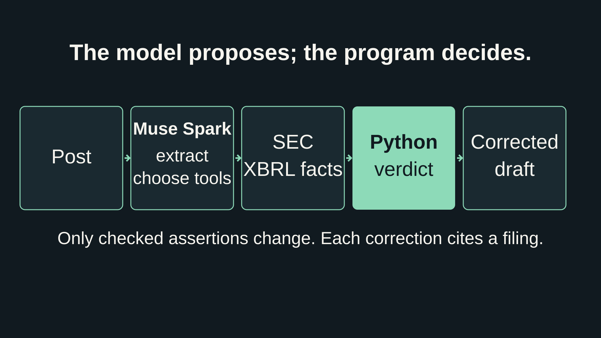
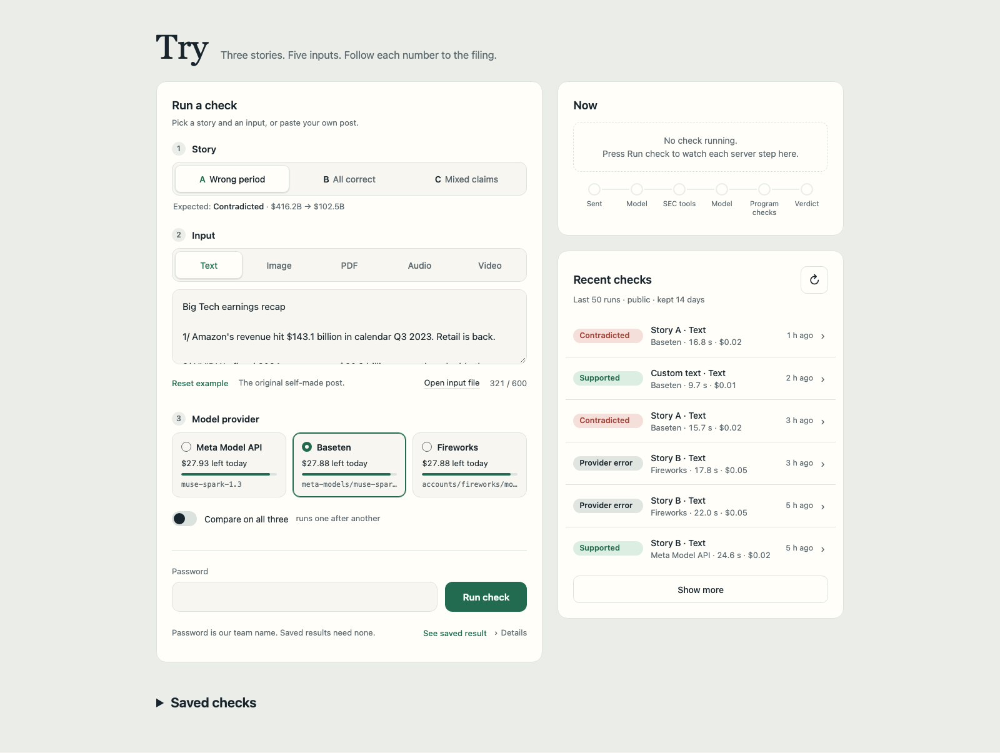
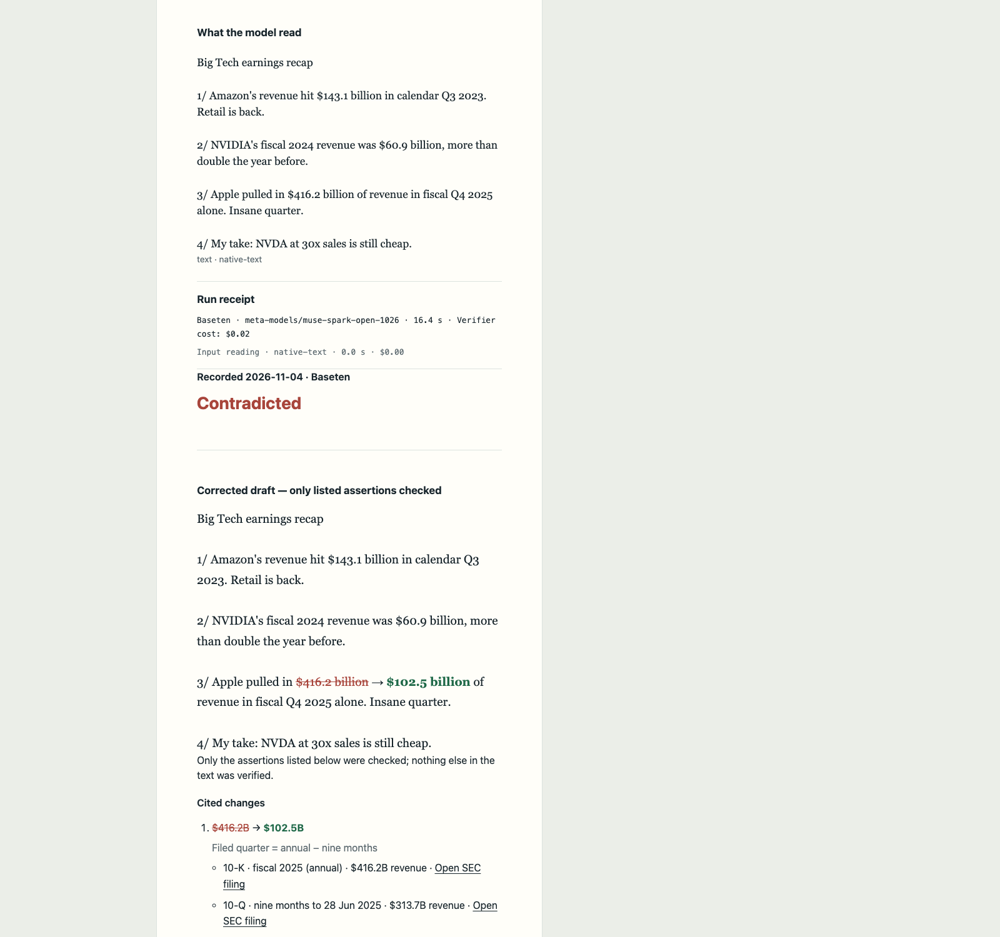

# Market Claim Verifier


**Paste a finance post. Every number is checked against SEC filings, and you get a corrected draft with citations.**

[Live site](https://hackathon.dappgo.com/) · [Judge guide](JUDGES.md) · [Evidence index](docs/evidence/INDEX.md)

## For judges — 3-minute path

| Step | Open | What to inspect |
| --- | --- | --- |
| Watch | [3-minute demo video](https://youtu.be/qIZTElkqpZc) | The post, filing, verdict and corrected draft in one walkthrough. |
| Try | [Live check](https://hackathon.dappgo.com/#live-check) | Password: the team name (dappgo). Choose a story, input and provider. |
| Replay | [Saved check](https://hackathon.dappgo.com/#recorded-run) | No password. Expand the SEC evidence and agent trace. This is a recorded run. |
| Audit | [Held-out benchmark report](docs/evidence/eval-v2-2026-10-27/REPORT.md#metrics) | Denominators, failures, costs and the corrected-gold disclosure. |

<a id="demo-video"></a>
Demo video (3 min): https://youtu.be/qIZTElkqpZc

<a id="agentic-muse-chooses-the-next-check-python-checks-the-answer"></a><a id="l4-earnings-release-evidence"></a>

## The idea

DappGo publishes US-market commentary. Internal fact checking found a recurring problem:
financial posts could contain the right number with the wrong period, unit or comparison.
A fluent explanation alone does not catch an annual revenue figure presented as a quarter.

**The model proposes; the program decides.** Muse Spark chooses evidence tools and proposes
an interpretation. Python binds the claim to returned evidence, calculates the comparison,
and determines supported, contradicted or insufficient evidence.

The useful combination is a program-decided verdict, a cited corrected draft and deterministic
evidence binding. A model-proposed number cannot become a correction merely because it sounds plausible.
The correction must use the program value and the filing citations retained with that check.



1. Read the input; extract each financial assertion without treating the input as evidence.
2. Muse Spark chooses tools such as `lookup_fact`, `compute_change`, `history_rank` and `list_periods`.
3. SEC results retain evidence IDs, issuer, metric, unit, period, accession and source hash.
4. Python parses the stated number, precision and comparator; validates evidence and fiscal/calendar periods.
5. The program calculates the verdict; a correction strikes a disproved value and inserts the cited filed value.
6. Save requests, tool calls, usage, cost and duration so the result can be inspected and replayed.

[Agent loop](src/claimcheck/agent.py) · [Program checks](src/claimcheck/checks.py) ·
[Correction builder](src/claimcheck/correction.py) · [Evidence-record contract](docs/EVIDENCE_RECORDS.md)

## What it does

### Inputs and coverage

| Area | Current contract | Source |
| --- | --- | --- |
| Site | Pasted text ≤600 characters; packaged examples in text, image, PDF, audio and video. Arbitrary browser uploads remain planned. | [Live contract](docs/LIVE_CHECK.md), [example report](docs/evidence/try-v3-site-2026-11-03/REPORT.md) |
| CLI | Text/Markdown, PNG/JPEG/WebP, native-text PDF, audio and video. Scanned PDFs are reported unchecked. | [Format probe report](docs/evidence/input-formats-2026-10-30/REPORT.md), [input limits](docs/PROVIDERS.md#current-repository-input-contract) |
| Companies | US-GAAP SEC filers: ≈8,000 companies; 23 tested. ETFs/funds and IFRS foreign filers have limited or unsupported coverage. | [Scope and count provenance](docs/evidence/REVIEW_GUIDE.md#facts-in-detail) |
| Periods | SEC XBRL periods, generally 2009 onward through the latest filing; annual, quarterly and growth comparisons. | [Scope report](docs/evidence/REVIEW_GUIDE.md#facts-in-detail), [period rules](docs/evidence/TECHNICAL_GUIDE.md#technical-notes) |
| Refresh | Live SEC cache refreshes every 6 h. Saved demonstrations retain their recorded sources. | [Live configuration report](docs/evidence/readme-v3-2026-11-04/REPORT.md#scope-and-limits) |

Media first becomes claim text. Images use Muse OCR; audio uses Muse Voice Transcribe;
video combines transcription with sampled frames. These steps can miss assertions, chart geometry
or the relationship between a number and its slide heading. They do not authenticate an upload.
[Provider and media boundaries](docs/PROVIDERS.md) · [Media study](docs/evidence/fair-multimodal-v1/REPORT.md)

### Outputs

| Output | Meaning |
| --- | --- |
| Verdict | Supported, contradicted or insufficient evidence for each extracted assertion. |
| Corrected draft | Strike the disproved number, insert the program value and cite its filing. Ambiguous edits remain unchanged with a reason. |
| SEC evidence | Values, units, periods and filing links; derived quarters cite their component filings. |
| Agent trace | Model requests, selected tools, returned evidence IDs and final program checks. |
| Receipt | Provider/model, estimated cost or retained upper bound, and measured duration. Media preprocessing is listed separately. |

Only the listed assertions were checked. A draft never labels the entire article “approved”.
[Correction report](docs/evidence/corrected-draft-2026-11-03/REPORT.md) · [Receipt contract](docs/LIVE_CHECK.md#provider-receipts-compare-and-history)

### Providers

All verifier routes use Meta models; the hosting provider and model variant are recorded separately.

| Route | Pinned verifier model | Media preprocessing |
| --- | --- | --- |
| Meta Model API | `muse-spark-1.3` | Meta OCR/ASR |
| Baseten | `meta-models/muse-spark-open-1026` | Meta OCR/ASR |
| Fireworks | `accounts/fireworks/models/muse-spark-open` | Meta OCR/ASR |

Open and closed Spark variants are different models. A vendor modality listing does not mean
this repository uses that provider's native image, audio or video endpoint.
[Provider report and measured boundaries](docs/PROVIDERS.md) · [Recorded model manifest](docs/evidence/eval-v2-2026-10-27/manifest.json)

<a id="run-it"></a><a id="try-it"></a>

## How to use

### On the site

Open [Try](https://hackathon.dappgo.com/#live-check). The selector offers
[3 stories × 5 input formats](docs/evidence/try-v3-site-2026-11-03/REPORT.md):
choose the wrong-period post (story A), an all-correct story or a mixed story.
Read the selected input before running it; unavailable saved media results are labelled pending.

<!-- readme-shot:try-story-a -->


Choose Meta Model API, Baseten or Fireworks. Baseten is selected by default. **Compare on all** runs the providers sequentially and charges each provider’s own daily and lifetime budget; exhausted members are labeled and skipped. Enter the judge password to run a new check;
**See saved result** requires none and preserves the historical receipt.

<!-- readme-shot:corrected-draft -->


Expand **SEC evidence** and **Agent trace** to inspect the verdict. Public history reopens a full
result; **Edit & re-run** restores its story, input and provider. Authenticated inputs and results
are public for [14 days](docs/evidence/readme-v3-2026-11-04/REPORT.md#scope-and-limits).
The screenshots show local rendering of retained data, not a new production run.
[Capture script](scripts/capture_readme_shots.py) · [Screenshot provenance](docs/evidence/readme-v3-2026-11-04/REPORT.md#screenshots)

### CLI quickstart

Requires Python 3.12–3.14 and `uv`; Node 22+ is also needed for full verification. [Prerequisites and offline verification](AGENTS.md#offline-verification).

```sh
git clone https://github.com/YanlongLai/market-claim-verifier.git
cd market-claim-verifier
uv sync
```

Inspect a request without a key, model call or SEC fetch:

```sh
uv run python -m claimcheck verify --provider baseten --dry-run \
  'META Q2 2025 revenue was $47.5B'
```

Set `BASETEN_API_KEY` in your environment, then verify a claim within an explicit spend ceiling:

```sh
uv run python -m claimcheck verify --provider baseten --budget 1 \
  'META Q2 2025 revenue was $47.5B'
```

Check a whole post and retain its HTML/JSON report:

```sh
uv run python -m claimcheck post examples/posts/bigtech-thread.txt \
  --provider baseten --budget 1
```

Read media before verifying its extracted assertions:

```sh
uv run python -m claimcheck ingest docs/examples/post.png --provider baseten --budget 1
uv run python -m claimcheck ingest docs/examples/post.pdf --provider baseten --budget 1
uv run python -m claimcheck ingest docs/examples/post.mp3 --provider baseten --budget 1
uv run python -m claimcheck ingest docs/examples/post.mp4 --provider baseten --budget 1
```

A readable excerpt of the [saved Apple correction](docs/evidence/posts-2026-10-28/demo-thread-baseten/report.json)
(the display rounds the retained source values; this is not newly generated CLI output):

```text
Claim: Apple revenue in fiscal Q4 2025 alone was $416.2B.
Program verdict: contradicted
Filed quarter: $102.5B = annual revenue minus nine-month revenue
Corrected draft: Apple revenue in fiscal Q4 2025 alone was ~~$416.2B~~ → $102.5B.
Citations: both component SEC filings retained in the report
```

[Correction calculation and replay limits](docs/evidence/corrected-draft-2026-11-03/REPORT.md#retained-apple-example)

### Models & keys

Choose `--provider meta`, `--provider baseten` or `--provider fireworks`; otherwise `CLAIMCHECK_PROVIDER` applies (CLI default: `meta`). All verifier models are Meta Muse models.

| Provider | Key environment variable | Key-file override and default | Default model ID |
| --- | --- | --- | --- |
| Meta Model API | `MODEL_API_KEY` | `MODEL_API_KEY_FILE`; `~/.config/dappgo/meta-model-api.env` (a `MODEL_API_KEY=your-key` line) | `muse-spark-1.3` |
| Baseten | `BASETEN_API_KEY` | `BASETEN_API_KEY_FILE`; `~/secret/baseten_api_key.txt` (raw key) | `meta-models/muse-spark-open-1026` |
| Fireworks | `FIREWORKS_API_KEY` | `FIREWORKS_API_KEY_FILE`; `~/secret/fireworks-api-key.txt` (raw key) | `accounts/fireworks/models/muse-spark-open` |

A nonempty environment key wins over its file. Keep key files outside the repository with `chmod 600`; never put keys in command arguments, recordings or commits.

Override the verifier with `--model ID` or `CLAIMCHECK_MODEL=ID` (flag wins). Use the exact IDs above; Meta also has ledger support for `muse-wonder-1.0`. Unknown pairs are refused before a paid model call. OCR always uses Meta `muse-spark-1.3`; ASR uses `muse-voice-transcribe-1.0`. Both require local `MODEL_API_KEY` or its Meta key file even for Baseten/Fireworks verification. Native-text PDF decoding needs no OCR key; audio/video requires FFmpeg/ffprobe.

`--budget` sets a USD ceiling for extraction and all verification calls (default: `CLAIMCHECK_BUDGET_USD` or $0.50); the selected provider's existing ledger spend counts. Ingest uses a separate ledger and splits mixed-provider budgets equally. `verify --dry-run` and `post --dry-run` skip key-file reads, model calls and SEC fetches; post previews only initial extraction. `ingest` has no dry-run flag. [Exact setup, precedence and budgets](docs/PROVIDERS.md#models--keys) · [CLI reference](docs/evidence/TECHNICAL_GUIDE.md#run-it).

**Online (site) vs Local (CLI).** The site uses Kubernetes Secret `live-check-secrets` in `dappgo-hackathon`, containing the three server keys below, `LIVE_CHECK_PASSWORD` and `LIVE_ORIGIN_TOKEN`. Visitors enter the review password; provider keys stay on the server. Site spending limits are separate from local ledgers. [Deployment](deploy/README.md#configuration-and-persistence) · [Real online log and local CLI recording](docs/REAL_TRACES.md).

| Provider | Online (site) | Local (CLI) |
| --- | --- | --- |
| Meta Model API | Server `META_MODEL_API_KEY` for verification and OCR/ASR | Your `MODEL_API_KEY` or Meta env file; `--provider meta` |
| Baseten | Server `BASETEN_API_KEY`; fixed default model | Your `BASETEN_API_KEY` or raw-key file; `--provider baseten` |
| Fireworks | Server `FIREWORKS_API_KEY`; fixed default model | Your `FIREWORKS_API_KEY` or raw-key file; `--provider fireworks` |

## Cost & speed

The headline is **$0.01 / 6 s live** ([production receipt](docs/evidence/live-prod-2026-11-03/REPORT.md))
and **$0.02 per claim / 10 s median** in the [Baseten benchmark](docs/evidence/eval-v2-2026-10-27/REPORT.md#metrics).
These are rounded recorded observations. The planning band below is not a measured minimum/maximum or an SLA.

| Workload | Estimated cost (USD) | Duration | Evidence and boundary |
| --- | --- | --- | --- |
| Live text check | $0.01–0.04 by input size | 6–90 s by provider | [Planning band and production receipt](docs/evidence/readme-v3-2026-11-04/REPORT.md#cost-and-speed); one production claim supports the rounded $0.01 / 6 s headline. |
| Live media example | Text verification + OCR/ASR preprocessing | Verification + preprocessing time | [Media report](docs/evidence/media-examples-2026-11-03/REPORT.md); no fixed surcharge. Meta preprocessing is itemized on the receipt. |
| Baseten benchmark claim | $0.02 per claim | 10 s median; p95 21 s | [Held-out text report](docs/evidence/eval-v2-2026-10-27/REPORT.md#metrics); rounded completed-case cost and latency. |
| Provider live budgets | Separate daily/lifetime caps for Meta, Baseten and Fireworks; code defaults $30/day and $20 lifetime each | Daily reset at UTC midnight | [Cap configuration](deploy/README.md#setting-provider-caps); operator sets real caps before rollout. Global ceilings additionally bound the sum. |

Provider meters show daily/lifetime room. Meta preprocessing charges Meta; legacy unattributed spend conservatively counts against every provider. [Migration and real cap settings](deploy/README.md#setting-provider-caps); [earlier shared-limit configuration](docs/evidence/readme-v3-2026-11-04/REPORT.md#scope-and-limits).
Longer posts can exceed the planning band: the retained multi-assertion example has its own
[cost and duration](docs/evidence/readme-v3-2026-11-04/REPORT.md#cost-and-speed).
A media document may produce many chargeable claims. Cost includes extraction, tool-loop calls,
retries and preprocessing; ledger estimates and retained reservations are not provider invoices.
[Pricing and accounting](docs/PROVIDERS.md#price-comparison) · [Reserve-before-call ledger](src/claimcheck/budget.py)

<a id="how-the-system-got-there"></a>

## Accuracy & evidence

**90.2% (240/266) held out; false support 1/139**
([original corrected-gold report](docs/evidence/eval-v2-2026-10-27/REPORT.md#metrics)).
False support counts reference contradicted/insufficient claims incorrectly labelled supported.
Failures and missing results count as wrong. This is text-benchmark accuracy, not accuracy on every post.

### Original benchmark

| Provider / method | All 357 claims | Held-out 266 claims | Report |
| --- | --- | --- | --- |
| Meta Model API · agent + SEC tools | 83.2% (297/357) | 82.0% (218/266) | [Original report](docs/evidence/eval-v2-2026-10-27/REPORT.md#metrics) |
| Meta Model API · single-shot | 44.3% (158/357) | 41.7% (111/266) | [Original report](docs/evidence/eval-v2-2026-10-27/REPORT.md#metrics) |
| Baseten · agent + SEC tools | 90.5% (323/357) | 90.2% (240/266) | [Original report](docs/evidence/eval-v2-2026-10-27/REPORT.md#metrics) |
| Baseten · single-shot | 20.7% (74/357) | 21.1% (56/266) | [Original report](docs/evidence/eval-v2-2026-10-27/REPORT.md#metrics) |
| Fireworks · agent + SEC tools | 90.5% (323/357) | 89.1% (237/266) | [Original report](docs/evidence/eval-v2-2026-10-27/REPORT.md#metrics) |
| Fireworks · single-shot | 19.9% (71/357) | 19.2% (51/266) | [Original report](docs/evidence/eval-v2-2026-10-27/REPORT.md#metrics) |

The all-claim column includes the development split; only the held-out column supplies the headline.
Claims were frozen before execution. Two gold answers were corrected afterward;
[registered-gold scores](docs/evidence/eval-v2-2026-10-27/REPORT-registered-gold.md),
[manifest](docs/evidence/eval-v2-2026-10-27/manifest.json) and
[per-claim explorer](https://hackathon.dappgo.com/explorer/) preserve the audit trail.
The [later agent rerun](docs/evidence/eval-v2-2026-10-28-r2-posthoc/REPORT.md) is post-hoc;
its empty single-shot rows are not results.

### Real-world and media evidence

| Study | What it establishes | Report |
| --- | --- | --- |
| 78 Threads / 80 news | Extraction and verification coverage, failures and costs; coverage ≠ accuracy. Sparse independent labels limit truth-accuracy claims. | [Original real-world report](docs/evidence/real-world-2026-11-02/REPORT.md), [source review](docs/evidence/real-world-2026-11-02/threads/GOLD_REVIEW.md) |
| Frozen-text fixcheck | Regression behavior on previously seen inputs; does not retest OCR/ASR. | [Post-hoc report](docs/evidence/real-world-2026-11-03-fixcheck/REPORT.md) |
| Paired media study | Shared frozen Meta preprocessing across formats; native image probes reported separately. | [Format report](docs/evidence/fair-multimodal-v1/REPORT.md) |
| Real webcast probes | Retained audio/video failures, event-period context and evidence gaps. | [Original AV report](docs/evidence/real-av-v1/REPORT.md), [context recheck](docs/evidence/real-av-context-live/REPORT.md) |

[Evidence index](docs/evidence/INDEX.md) · [Real-world explorer](https://hackathon.dappgo.com/wild/) ·
[Test-record retention policy](docs/TEST_RECORDS.md) · [Versioned evidence exports](docs/EVIDENCE_RECORDS.md)

### Verify offline

```sh
bash scripts/verify.sh
# After the locked dependency cache is populated:
UV_OFFLINE=1 bash scripts/verify.sh
```

The runner installs locked dependencies, then runs Python/Node suites with network guards and no provider keys.
It rebuilds figures, checks saved-data reproducibility and validates Markdown links in a disposable copy.
It does not run live evaluation, fetch SEC data or render a full demo video.
[Verification receipt](docs/VERIFICATION.md) · [Verification guide](AGENTS.md)

## Limits & honesty

| Limit | Consequence |
| --- | --- |
| Corrected gold | The headline uses corrected labels; the registered-gold report remains available. |
| Dirty run tree | The original manifest records a dirty working tree; saved results describe that recorded run. |
| Seen-input rechecks | Post-hoc and frozen-transcript rechecks are regression evidence, not fresh held-out evaluation; OCR/ASR is not retested. |
| Extraction and sources | Missing assertions, ambiguous periods, restatements, non-GAAP definitions and sampled frames can prevent a check. |
| Rate and spend | 5 checks / 10 min per IP; [independent provider caps and an aggregate ceiling](docs/LIVE_CHECK.md#atomic-cost-cap). Compare skips exhausted providers; a rate stop ends the sequence. |
| Corrections | Only uniquely bound disproved numbers change. Opinions and unchecked text remain; “approved” never describes the article. |

[Full limits](docs/evidence/REVIEW_GUIDE.md#limits) · [Source tiers](docs/DATA_SOURCES.md) ·
[Historical filing-date policy](docs/VERIFICATION_POLICY.md). This project is not investment advice.

## Repository map

| Path | Purpose |
| --- | --- |
| [src/claimcheck/](src/claimcheck) | Agent loop, SEC tools, providers, deterministic checks and corrections |
| [prompts/](prompts) | Versioned prompt source; recorded runs retain hashes |
| [eval/v2/](eval/v2) | Frozen claims, corrected labels and independent gold calculations |
| [docs/evidence/](docs/evidence) | Reports, manifests, redacted traces and paid-attempt records |
| [docs/site/](docs/site) | Landing page, bilingual data and committed artwork |
| [docs/explorer/](docs/explorer) | Per-claim benchmark explorer |
| [server/live/](server/live) / [workers/live/](workers/live) | Shared-ledger live service and runner |
| [tests/](tests) | Offline fixtures, program regressions and site lifecycle tests |
| [scripts/](scripts) / [docs/scripts/](docs/scripts) | Verification, screenshot capture and data/figure builders |
| [demo/](demo) | Standalone demo production, tests and build disclosures |

<a id="technical-reference"></a><a id="reproduce-or-extend"></a>

## Run locally

```sh
uv sync
uv run python scripts/serve_site.py --port 8765
# Open http://127.0.0.1:8765/
```

The preview serves the Pages overlay and committed saved results. Live API routes require the
separate [self-hosted service setup](docs/LIVE_CHECK.md#exact-handoff-for-claude--owner).
Use the [extension guide](docs/EXTENDING.md) for new evidence connectors and
[planned work](ROADMAP.md) for unfinished product capabilities.

## Licence & credits

Code: [MIT](LICENSE). Financial evidence: SEC EDGAR filings, with issuer and accession attribution.
Models: Meta Muse Spark and Muse Voice Transcribe, hosted through the recorded provider routes.
[Credits and media provenance](CREDITS.md) distinguish model-generated artwork and narration from financial evidence.

DappGo existed before the hackathon; the verifier, site and evidence were built during it.
[Build disclosure](BUILD_LOG.md#build-log) · [Changelog](CHANGELOG.md) · [Traditional Chinese](README.zh-TW.md)
