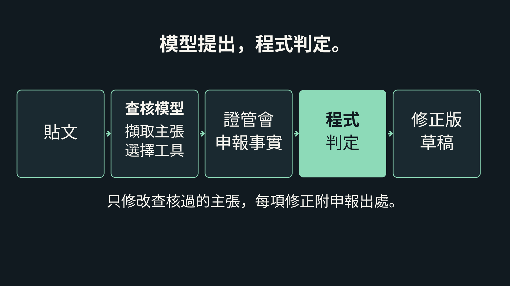

# 財經主張查核器


<!-- 此為靜態佔位圖；請於主機執行擷取指令後替換。 -->

**貼上財經貼文，逐一用美國證管會申報資料核對數字，並產出附出處的修正版草稿。**

[試用網站](https://hackathon.dappgo.com/zh/) · [已儲存查核](https://hackathon.dappgo.com/zh/#recorded-run) · [評審指南](JUDGES.zh-TW.md) · [英文](README.md)

## 功能

- 從文字或媒體擷取財務主張。
- 模型選擇申報查找工具；程式核對數字、期間與證據識別碼。
- 回傳支持、矛盾或證據不足，並為被證明錯誤的數字提供附出處的修正版草稿。

## 為什麼做

團隊原本就發布美股評論。
內部查核發現，正確的數字也可能配錯期間、單位或比較方式。
模型提出，程式判定。

## 運作方式



1. 讀取輸入，擷取每項財務主張。
2. 模型選擇下一個申報查找工具。
3. 將回傳證據綁定至公司、指標與期間。
4. 程式計算判定並核對數值容差。
5. 只修正被證明錯誤的數字，並附申報出處。

[在網站跟著一個數字查到底](https://hackathon.dappgo.com/zh/#how) · [模型與程式分工](docs/evidence/TECHNICAL_GUIDE.md#agentic-muse-chooses-the-next-check-python-checks-the-answer)

## 試用

[網站](https://hackathon.dappgo.com/zh/#live-check)提供 3 個故事 × 5 種輸入（文字、圖片、文件、音訊、影片）。可選擇三家供應商或比較全部；公開歷史可重新開啟完整結果，**編輯並重新查核**會還原故事、輸入與供應商。評審密碼見提交說明；已儲存範例免密碼。

命令列範例需先完成[本機設定](#本機執行)。第一個指令離線預覽；後兩個需供應商金鑰，並在指定預算內付費執行。

```sh
uv run python -m claimcheck verify --provider baseten --dry-run 'META 2025 年第 2 季營收為 $47.5B'
uv run python -m claimcheck verify --provider baseten --budget 1 'META 2025 年第 2 季營收為 $47.5B'
uv run python -m claimcheck post examples/posts/bigtech-thread.txt --provider baseten --budget 1
```

## 產品事實

| 項目 | 答案 |
| --- | --- |
| 查核內容 | [以美國證管會申報核對財務主張，提供判定與附出處的修正。](docs/evidence/REVIEW_GUIDE.md#facts-in-detail) |
| 涵蓋範圍 | [美國會計準則申報公司：約 8,000 家，已測試 23 家。結構化申報期間大致自 2009 年起至最新申報。](docs/evidence/REVIEW_GUIDE.md#facts-in-detail) |
| 輸入格式 | [網站：≤600 字元。命令列：文字、圖片、文字型文件、音訊與影片。](docs/evidence/TECHNICAL_GUIDE.md#run-it) |
| 費用與速度 | [即時查核每次 $0.01；即時 6–20 秒（單一主張 → 含四項主張的貼文）。基準測試每題 $0.02；中位數 10 秒。每日 $10；累計 $60。](docs/evidence/REVIEW_GUIDE.md#facts-in-detail) |
| 準確率 | [保留測試 90.2% (240/266)；誤判為支持 1/139。](docs/evidence/eval-v2-2026-10-27/REPORT.md#metrics) |
| 修正範圍 | [修正被證明錯誤的數字，並附申報出處。絕不標示整篇文章已核准。](docs/evidence/posts-2026-10-28/demo-thread-baseten/report.json) |

## 證據與誠實揭露

[保留測試](docs/evidence/eval-v2-2026-10-27/REPORT.md#metrics) · [原先登記答案的分數](docs/evidence/eval-v2-2026-10-27/REPORT-registered-gold.md) · [執行清單](docs/evidence/eval-v2-2026-10-27/manifest.json) · [真實貼文涵蓋率](https://hackathon.dappgo.com/wild/) · [結果瀏覽器](https://hackathon.dappgo.com/explorer/index.zh.html) · [證據索引](docs/evidence/INDEX.md) · [完整限制](docs/evidence/REVIEW_GUIDE.md#limits)

- 原始執行後修正了兩題參考答案；原先登記答案的分數仍保留。
- 執行清單記錄當時工作目錄有未提交的變更。
- 事後重查使用已看過的輸入，不是全新的保留測試。
- 凍結對話重查未重測圖片辨識或語音轉錄；擷取可能遺漏主張。
- 即時查核共用每日 $10、累計 $60 預算；每個網路位址每 10 分鐘限 5 次。驗證後的查核公開保留 14 天。

## 程式庫導覽

| 路徑 | 用途 |
| --- | --- |
| [查核核心](src/claimcheck) | 工具迴圈、供應商、程式檢查與修正 |
| [提示詞](prompts) | 版本化文字與雜湊 |
| [第二版測試](eval/v2) | 凍結主張、修正後答案與參考計算 |
| [證據](docs/evidence) | 報告、去敏紀錄與失敗嘗試 |
| [英文網站](docs/site) | 英文頁、本機素材與已儲存資料 |
| [繁中網站](docs/zh) | 自動產生的繁體中文鏡像 |
| [即時服務](server/live) | 自架程式服務與持久歷史 |
| [同源介面](functions/api) | 網站請求轉送 |
| [測試](tests) | 離線固定資料與產品／網站回歸 |
| [展示](demo) | 展示原始檔、旁白與保留製作紀錄 |

## 本機執行

需 3.12–3.14 版直譯器、套件工具與 22 版以上執行環境，依下列指令設定：

```sh
uv sync --frozen
python3 scripts/serve_site.py
bash scripts/verify.sh
```

本機預覽使用已提交檔案。驗證在可拋棄副本中執行，移除金鑰並禁止測試及建置器連網。快取備妥後，可用 `UV_OFFLINE=1 bash scripts/verify.sh` 離線安裝相依套件。[驗證指南](AGENTS.md) · [保留測試紀錄](docs/TEST_RECORDS.md) · [命令列細節](docs/evidence/TECHNICAL_GUIDE.md#run-it)

請在主機執行[擷取腳本](scripts/capture_readme_gif.py)，將佔位圖替換為寬 720 像素、6–8 秒、低於 3 百萬位元組的循環動圖；擷取只讀取本機已儲存場景。

## 授權

[開放原始碼授權](LICENSE) · [出處與致謝](CREDITS.md)。原有服務在黑客松前已存在；此查核器、網站與證據自 2026-10-27 起於黑客松期間建立。[建置揭露](BUILD_LOG.md#build-log)。

<a id="agentic-muse-chooses-the-next-check-python-checks-the-answer"></a><a id="check-a-whole-post"></a><a id="cost-speed-and-provider-choice"></a><a id="evaluation"></a><a id="evidence-you-can-audit"></a><a id="gap-score"></a><a id="how-meta-models-are-used"></a><a id="how-the-system-got-there"></a><a id="key-results"></a><a id="l4-earnings-release-evidence"></a><a id="limitations"></a><a id="local-pdf-input"></a><a id="one-real-run"></a><a id="other-inputs"></a><a id="real-results"></a><a id="real-world-test"></a><a id="reproduce-or-extend"></a><a id="review-several-files-for-one-stock"></a><a id="run-it"></a><a id="support-and-boundaries"></a><a id="technical-notes"></a><a id="technical-reference"></a><a id="text-verification-266-held-out-claims"></a><a id="try-it"></a><a id="what-it-does"></a><a id="why-meta-open-weights"></a><a id="why-you-can-trust-a-verdict"></a>
