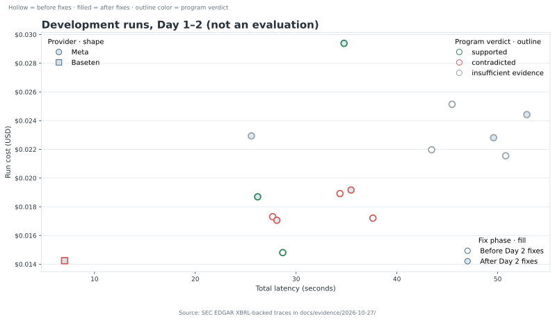

# Visuals

All evidence-backed charts and cards are generated offline. Regenerate them and refresh README captions with:

```bash
.venv/bin/python docs/scripts/make_figures.py --all
.venv/bin/python docs/scripts/make_figures.py --check
```

Rerun after an evaluation, after live runs that should be shown, after a `BUILD_LOG.md` evidence edit, or after editing a Mermaid source. The default selects the latest complete `docs/evidence/eval-*/summary.json`; use `--eval <dir>` to choose a specific complete evaluation. The hero image is a checked-in asset; its exact reusable prompt and variants are in [`prompts/hero-image.md`](prompts/hero-image.md).

## Registry

<!-- registry:figures:start -->
| ID | Kind | Output | Generator | Data sources | README section | Inputs SHA-256 |
| --- | --- | --- | --- | --- | --- | --- |
| `hero` | ai_image | [`docs/figures/hero.png`](figures/hero.png) | `docs/prompts/hero-image.md` | `docs/prompts/hero-image.md` | Overview | `d0d8e471cf9a…` |
| `before-after` | chart | [`docs/figures/before-after.svg`](figures/before-after.svg)<br>[`docs/figures/before-after.png`](figures/before-after.png)<br>`README.md` | `make_before_after` | `BUILD_LOG.md` | Real results | `2c238c044d02…` |
| `verdict-cards` | card | [`docs/figures/verdict-cards.svg`](figures/verdict-cards.svg)<br>[`docs/figures/verdict-cards.png`](figures/verdict-cards.png)<br>`README.md` | `make_verdict_cards` | `docs/evidence/2026-10-27/20261027T221321Z-79b60e38.json`<br>`docs/evidence/2026-10-27/20261027T231724Z-07dbb1c6.json` | What it does | `27bbdbde24ea…` |
| `eval-summary` | chart | [`docs/figures/eval-summary.svg`](figures/eval-summary.svg)<br>[`docs/figures/eval-summary.png`](figures/eval-summary.png)<br>`README.md` | `make_eval_summary` | `docs/evidence/eval-v2-2026-10-27/*.json` | Real results | `a15d95b1a017…` |
| `data-quality` | chart | [`docs/figures/data-quality.svg`](figures/data-quality.svg)<br>[`docs/figures/data-quality.png`](figures/data-quality.png) | `make_data_quality` | `docs/evidence/data-quality-2026-10-27.json` | Data quality | `1bd68aa8e9cf…` |
| `live-cost-latency` | chart | [`docs/figures/live-cost-latency.svg`](figures/live-cost-latency.svg)<br>[`docs/figures/live-cost-latency.png`](figures/live-cost-latency.png)<br>`README.md`<br>`docs/VISUALS.md` | `make_live_cost_latency` | `BUILD_LOG.md`<br>`docs/evidence/2026-10-27/*.json` | Real results / Visuals index | `ff330ed86c5c…` |
| `how-a-claim-is-checked` | diagram | `README.md` | `docs/diagrams/how-a-claim-is-checked.mmd` | `docs/diagrams/how-a-claim-is-checked.mmd` | What it does | `6d1c5ecc0209…` |
| `real-run-sequence` | diagram | `README.md` | `docs/diagrams/real-run-sequence.mmd` | `docs/diagrams/real-run-sequence.mmd` | Real results | `5e96a42147b4…` |
| `providers` | diagram | `README.md` | `docs/diagrams/providers.mmd` | `docs/diagrams/providers.mmd` | How Meta models are used | `a814e9defecc…` |
| `model-vs-program` | diagram | `README.md` | `docs/diagrams/model-vs-program.mmd` | `docs/diagrams/model-vs-program.mmd` | Why you can trust a verdict | `b1975853601c…` |
<!-- registry:figures:end -->

## Development run chart

<!-- figure:live-cost-latency:start -->


*Development runs, Day 1–2: n = 16 traces; hollow markers are pre-fix and filled markers are post-fix.*
<!-- figure:live-cost-latency:end -->
